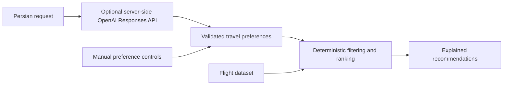

# Torob Belit · ترب بلیط

## Project Overview

Torob Belit is an **AI-assisted flight discovery, comparison, and referral platform**, built as an AI Product Engineer hiring assignment. Its Persian interface helps travelers compare flight suitability and seller conditions, then continue to an external agency to purchase.

The local demo requires no provider credentials. Torob Belit does not process payments, reserve inventory, or issue tickets.

## Problem Statement

The lowest fare may have unsuitable departure times, limited baggage, restrictive refunds, or insufficient cancellation history. Comparing these tradeoffs across sellers is difficult when conditions differ or evidence is missing. Torob Belit makes those differences visible and ranks options against the traveler’s requirements.

## Key Features

- **Flight search:** One-way/round-trip routes, searchable airports, route swapping, Jalali dates, and 1–9 adults.
- **Comparison:** Compare two or three itineraries with exact seller fares, baggage, refund/change terms, schedules, and aircraft information.
- **Filters and sorting:** Price range, airline, departure period, nonstop service, baggage, and history filters; suitability, price, duration, departure, and history sorts.
- **Cancellation history:** Categories and evidence dialogs show counts, periods, coverage, sources, and insufficient-data states.
- **AI Flight Assistant:** Conversation UI, editable preferences, and up to three explained recommendations. Manual controls work offline; successful real inference is unverified after a quota/billing failure.
- **Agency referrals:** Reviewed HTTPS search links for Alibaba, Flytoday, and MrBilit open in a new tab; unknown sellers remain unavailable.
- **Localization:** Responsive Persian RTL, local Yekan Bakh FaNum, Jalali dates, and Toman prices; internal values use Gregorian ISO dates and integer rials.

## AI-Native Development

Product and engineering decisions are recorded alongside the implementation:

- [PRD](docs/PRD.md) defines the current product scope, acceptance criteria, and data-truthfulness requirements.
- [DESIGN.md](DESIGN.md) governs visual tokens, typography, spacing, and component styling.
- [AGENTS.md](AGENTS.md) gives Codex project-wide rules for architecture, implementation boundaries, disclosure, and verification.
- [Architecture](docs/ARCHITECTURE.md) separates domain logic, application services, provider adapters, routes, and UI.

Codex supported implementation, incremental refactoring, and regression testing against these documents. Its development role is separate from the product’s optional runtime AI integration.

## AI Architecture

Natural-language understanding and flight recommendation logic have separate responsibilities:



`POST /api/assistant/interpret` requests strict structured preference patches and validates airports, dates, passengers, budgets, and conflicts with confirmed fields. The model cannot supply flights, prices, sellers, availability, cancellation records, or scores.

`POST /api/assistant/recommend` applies hard constraints before deterministic ranking across price, history, departure, duration, stops, baggage, refundability, and airline preferences. Explanations use computed factors. Round trips retain compatible selected legs and a combined budget.

**Operational status:** The [recorded OpenAI check](docs/OPENAI_ACTIVATION.md) authenticated successfully, but interpretation failed on quota/billing. Successful Persian extraction remains unverified. Failures preserve manual preferences and deterministic recommendations without simulating AI responses.

Live provider connections and verified operational-history feeds remain future work; adapter interfaces already exist.

## Technology Stack

| Area | Implementation |
| --- | --- |
| Application | Next.js 16 App Router, React 19, strict TypeScript |
| Styling | Tailwind CSS v4, CSS Modules, local Yekan Bakh FaNum via `next/font/local` |
| Server | Next.js Route Handlers and server-only service/provider modules |
| AI transport | OpenAI Responses API through native `fetch`; strict JSON Schema and application validation |
| Date/time | `@js-temporal/polyfill` and `Intl` formatting |
| Icons | Lucide React and shared local solid-icon mappings |
| Verification | Vitest, Playwright, ESLint, TypeScript compiler |

No database or internal payment/booking service is used.

## Getting Started

### Install and run

Use **Node.js 24** as specified in `.nvmrc`, with npm:

```sh
npm ci
npm run dev -- --hostname 127.0.0.1 --port 3000
```

Open [the local app](http://localhost:3000), select airports, a future date, and adults, then search. Tehran Mehrabad–Mashhad is supported. Visit [the assistant](http://localhost:3000/ai-assistant) for preference-based recommendations.

Demo search and manual recommendations need no environment variables. Fonts/assets are local. `sh scripts/dev.sh` also supports the workspace’s ignored runtime directory.

### Optional AI configuration

Create local configuration without overwriting an existing file:

```sh
cp -n .env.example .env.local
```

Set `OPENAI_API_KEY` and `OPENAI_MODEL` for your OpenAI project. Both are required; the model must support Responses and strict structured outputs. Confirm model access and available quota, then restart the server.

`.env.local` is Git-ignored. Keep secrets server-side; never use `NEXT_PUBLIC_*` or commit credentials. This configuration does not enable flight-provider access.

### Tests and production build

```sh
npm run lint
npm run build
npm run typecheck
npm test
npm run test:e2e
```

Build first to generate route types and production assets. Playwright uses port **3100**, disables real AI credentials, and intercepts seller navigation. It uses installed Google Chrome on macOS when available; otherwise install Chromium:

```sh
npx playwright install chromium
```

To run the production application separately:

```sh
npm run start -- --hostname 127.0.0.1 --port 3000
```

The [last recorded verification](docs/METASEARCH.md) passed lint, TypeScript, build, **700 unit tests**, and **124 browser tests**. These verify local behavior, not live inventory, external booking, or real AI inference.

## Data Sources and Limitations

| Mode | Current behavior |
| --- | --- |
| `demo` — default | Synthetic flights: six domestic routes from Tehran Mehrabad and their reverses, sixteen itineraries per route, three offers per itinerary. |
| `fixture` | Imported Alibaba THR–MHD/THR–SYZ records on `2026-10-15`; original price units/capture provenance are unverified, so comparable Toman prices remain unavailable. |
| `live` | Alibaba, Flytoday, Safarmarket, and Snapptrip are disconnected. Statuses are explicit; there is no synthetic fallback. |

Select a mode explicitly with `?mode=demo`, `?mode=fixture`, or `?mode=live`; omitted mode uses the demo. Authored demo dates span `2026-10-15`–`2036-12-31`; unsupported routes produce an informative empty state.

- **Synthetic inventory:** Real airline names and plausible aircraft models do not make sample flights, availability, or prices real. No live inventory or pricing is guaranteed.
- **Historical evidence:** Rates use matching operations over the previous 30 completed origin-local days, with at least 10 known outcomes and 80% verified-roster coverage. Demo observations use a fixed synthetic reference clock. Rates are retrospective, not calibrated future cancellation probabilities. Missing trustworthy history remains unknown.
- **External purchases:** Links continue to public seller search pages, not matching offers. Final terms belong to the seller; no partnership, price guarantee, or uptime is implied. Alibaba’s published entry could not be directly fetched during review.
- **AI limitations:** The last real interpretation failed on quota/billing; controlled tests do not certify model accuracy.
- **Product boundaries:** Adult-only, curated-airport searches are supported. Accounts, payments, ticket issuance, and My Tickets are unavailable.

See the [provider audit](docs/DATA_SOURCE_AUDIT.md), [data-source status](docs/DATA_SOURCES.md), [seller destination evidence](docs/SELLER_DESTINATIONS.md), and [localization notes](docs/LOCALIZATION.md).

## Project Structure

```text
src/
  app/                     Homepage, results, assistant, and API routes
  components/              Search, cards, dialogs, comparison, and assistant UI
  domain/                  Typed models, intent validation, money, dates, history
  application/             Search, offer normalization, and recommendation logic
  server/ai/               Responses transport, structured contract, validation
  server/providers/        Provider interfaces, aggregation, and reference parser
  data/                    Airport, airline, branding, and seller metadata
  fixtures/                Authored demo data and sanitized Alibaba responses
  lib/                     Airport matching and preference persistence
public/                    Local fonts, approved branding, images, and logos
tests/                     Unit tests and Playwright browser regressions
docs/                      Requirements, architecture, audits, and evidence
DESIGN.md                  Visual source of truth
AGENTS.md                  Development rules for Codex
.env.example               Credential-free configuration template
```

Routes are `/`, `/results`, and `/ai-assistant`, plus search/demo and assistant handlers under `/api`. Checkout and ticket routes are removed. [Delivery notes](docs/METASEARCH.md) contain the file inventory and verification evidence.

## Demo

- **Live website URL:** Not deployed yet.
- **GitHub repository URL:** https://github.com/Mahdibarmaki/torob-belit
- **Five-minute demo video:** Sent

[Current UI captures](docs/screenshots/metasearch/) show the local seller-referral and round-trip planning experience.
