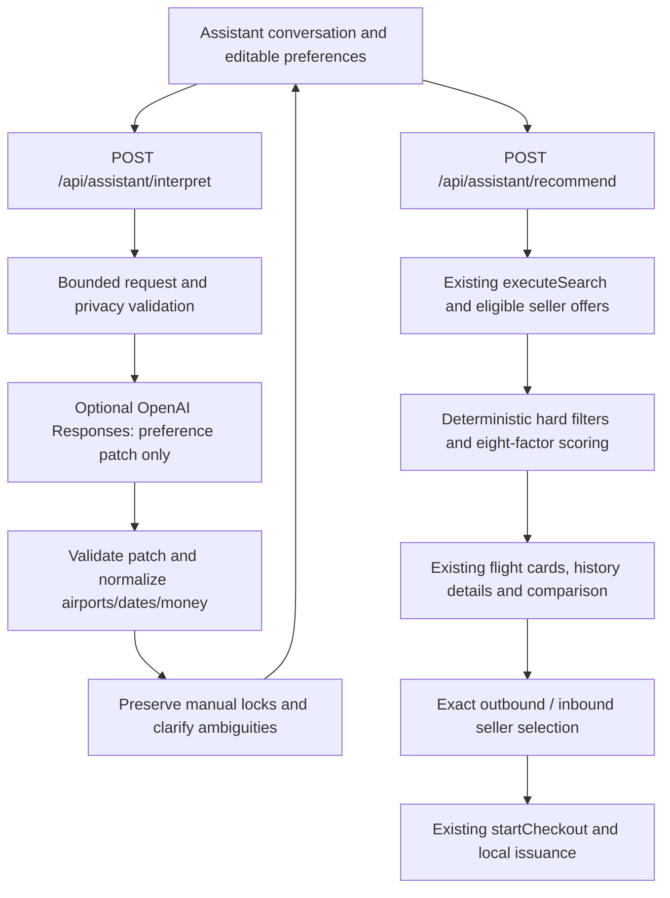

# دستیار هوشمند سفر

> **Current purchase journey — 2026-10-17:** The assistant preserves preferences, conversation, deterministic recommendations and seller comparison, then refers purchases to verified external seller destinations through the existing flight details. [METASEARCH.md](METASEARCH.md) supersedes all checkout, passenger, local issuance, My Tickets and ticket/PDF references below. Those passages and their test results describe the earlier delivery; no internal booking or ticket management remains active.

**Current UI refinement:** [AI_UI_REFINEMENTS.md](AI_UI_REFINEMENTS.md) supersedes
the initial entry/chat/diagnostic presentation described below. The lavender
joined tab appears on regular search only; the assistant page uses clean welcome
and opposing chat bubbles, a primary `اعمال ترجیحات`, source-linked logo credits
and no setup-status or unset-budget notices. Functional architecture is unchanged.

The assistant is an additive Next.js route at `/ai-assistant`. It preserves the
current Torob Belit `DESIGN.md`, local Yekan Bakh FaNum, RTL, Jalali presentation,
numeric rials/Toman display, inventory modes, historical-cancellation policy and
the existing local issuance system. No dependency was added, no flight fixture
or historical observation was changed, and ordinary search keeps its existing
filter/ranking behavior.

**Current external limit:** the subsequent activation check found the supplied
key and selected `gpt-5.6-luna`. Model-list authentication succeeded, but the real
Persian interpretation request failed with a quota/billing response. Real model
quality and successful interpretation remain unverified. The running experience
reports the specific quota failure and supports structured, deterministic
recommendations independently. [OPENAI_ACTIVATION.md](OPENAI_ACTIVATION.md) records
this activation result. [AI_PROVIDER.md](AI_PROVIDER.md)
contains the exact provider contract, official sources, environment variables,
limits and privacy boundaries.

## Requirement checklist

| Requirement | Status / implementation |
| --- | --- |
| Connected floating entry | Implemented: joined top-right lavender tab on regular search only, filled Sparkles, 48px target and source-mode-preserving route. One-way/round-trip tabs remain independent; no repeated tab inside the assistant. |
| Dedicated minimal experience | Implemented: shared header, ordinary-search return link, constrained white/neutral layout and centered introductory hierarchy. |
| Airline row | Implemented with four existing verified local identities: Iran Air, Zagros, Meraj and ATA. Original proportions and accessible credits retained; no endorsement or invented Qeshm/Mahan/Aseman artwork. |
| Welcome copy and suggestions | Implemented: exact requested title/description and four actionable prompts. Submitting replaces the large welcome area with opposing user/assistant bubbles without avatars or repeated role headings. |
| Composer | Implemented: Persian multiline text, Shift+Enter newline, Enter submit, IME guards, empty/double-submit prevention, processing state, restrained focus, safe-area and visual-viewport keyboard handling. No fake microphone/upload actions. |
| Persian interpretation | Implemented as a server-only optional real-model adapter; **actual external success unavailable/unverified**. It accepts preference changes only and never supplies flight data. |
| Structured state and correction | Implemented: compact collapsible summary, existing airport/Jalali selectors, adults, whole-journey Toman budget, separate hard requirements and soft preferences, explicit correction controls. |
| Clarification and continuity | Implemented: strict patches preserve omitted fields, explicit clock/timezone normalization, targeted missing/ambiguous questions, manual locks and acceptance/rejection of proposed changes. Controlled provider tests cover follow-ups; no-key mode does not pretend to interpret language. |
| Deterministic filtering | Implemented: existing eligible source offers, exact route/date/party, all applicable hard constraints on a single seller offer, complete prices, sufficient historical evidence and explicit unknown handling. |
| Recommendation ranking | Implemented: eight documented dimensions, explicit weights/boosts, fixed references, neutral missing values, correlation cap and stable tie-breaking. Separate from the existing search policy and LLM. |
| Explanations | Implemented: actual selected-fare values, active factors and missing evidence in the shared dialog; no model-authored inventory claims or forecast percentages. |
| Three recommendations | Implemented: up to three distinct flight choices. Round trips use the best compatible whole journey per displayed outbound, then per inbound after pinning the selected outbound offer. |
| Comparison and seller details | Implemented through unchanged `FlightCard`, `ComparisonPanel`, provenance and historical-evidence dialogs. Comparisons reset when their intent/direction context changes. |
| Booking and My Tickets | Implemented through existing exact `JourneySelection`, `parseJourneySelection`, `startCheckout`, passenger/review/issuance pages and persistent local ticket records. No second checkout or real reservation. |
| Round trips | Implemented: explicit outbound offer → compatible inbound offer → combined review → existing checkout. Global budget covers both legs once; chronology and exact fare pinning are enforced. |
| Empty/error/unavailable states | Implemented: no matches, invalid selections, no key, timeout/refusal/invalid model response, source failure and unsupported unpriced reference mode remain truthful. No live/demo fallback. |
| Persistence | Implemented: validated preference state and confirmed paths only in session storage; no raw chat or passenger documents. Refresh restores preferences without silently running another search. |
| Security | Implemented: server-only credentials, fixed documented API destination, strict allowlists, bounded requests/responses, no model tools, no logging/raw errors, personal-data screen, timeout and process-local usage guards. Production authentication/distributed abuse controls remain outside the local demo. |
| Responsive/accessibility | Verified at 375/430/768/1024/1440/1920px in production Chrome. Native dialogs/selectors, clear labels, keyboard focus and live announcements reused; mobile keyboard viewport emulated. |

The two new AI reference screenshots were not present as local assets; the
written hierarchy and connected-tab behavior were implemented using the current
design tokens. Existing travel reference screenshots did not override the
assistant's requested minimal conversational layout. This is not a pixel-match
claim.

## Runtime boundaries

`TravelIntent` in `src/domain/assistant-intent.ts` contains nullable exact
airports and ISO date-only fields, trip type, separate passenger categories and
explicit inventory mode. `hard` holds complete-party/whole-journey budget rials,
nonstop, minimum checked baggage per adult/segment, refundability, airline IDs,
mandatory departure period and sufficient historical categories. `soft` holds
prioritized dimensions, preferred departure period and preferred airline IDs.
Children/infants remain represented when requested but block the current
adult-only search/issuance until the user explicitly corrects them.

`IntentPatch` is a strict nested partial update, with an allowlisted `IntentField`
set for confirmed selections. The model's separate strict transport uses null
for no change and an explicit clear list. The server normalizes raw city names,
Jalali/relative date mentions and tagged money before constructing this patch.
Mode changes and invented flight fields are rejected. Manual controls are
authoritative; conflicting proposals require explicit acceptance.

Date interpretation uses a fresh server `now`, `Asia/Tehran` and source-specific
date bounds. Ambiguous Friday/weekend requests ask a question. The user's
unqualified Persian budget follows the UI's explicit Toman convention; explicit
rial input is converted zero times and Toman input exactly once. Foreign/mixed
currency and ambiguous total/per-person scope ask for clarification. This
convention does not authorize guessing a reference-provider price unit. The
fixed synthetic operations-history reference never advances with the AI clock.

## Filtering and scoring

The assistant receives base results only through the existing search service.
Every selected fare must independently satisfy availability, party, protected
ticket, complete canonical price, source, baggage/refund and other hard
requirements. Unknown positive requirements fail. Unpriced reference records
cannot enter price recommendations or local checkout. Explicit live mode uses
only its actual provider responses and exposes provider statuses, without demo
substitution.

Ranking policy `assistant-ranking-v1` has base weights:

| Price | History | Departure | Duration | Stops | Baggage | Refundability | Airline |
| --- | --- | --- | --- | --- | --- | --- | --- |
| 30 | 10 | 15 | 15 | 10 | 8 | 7 | 5 |

Requested priorities multiply their weight by two. Optional, unrequested
schedule/baggage/refund/airline dimensions deactivate globally. The combined
duration/stops weight is capped at 25 to avoid repeatedly rewarding connection
time. Active weights normalize globally, not separately per candidate.

- Price utility uses complete party total divided by the existing fixed
  125,000,000-rial per-adult reference, scaled by direction count. It never
  multiplies an already-totalled fare by passengers again.
- Duration uses mean direction duration and the existing 360-minute reference.
  Stops use mean `1 / (1 + stops)`.
- Departure uses explicit origin-local windows and bounded circular distance
  from the requested period; mandatory periods filter before this step.
- History uses the worst sufficient observed leg fraction as a ranking input,
  with unknown neutral. It is neither a combined journey rate nor a future
  probability. Existing roster/sample/coverage calculations remain unchanged.
- Baggage uses the minimum known checked allowance across the selected legs,
  capped at a 30kg reference. Refundability and preferred-airline compatibility
  use actual selected offers/segments. Unknown data receive neutral utility
  0.5 and cannot generate positive explanations.
- Stable order is score, complete journey price, total duration, then flight
  and offer IDs. No random values or model-produced scores enter ranking.

Round trips evaluate compatible reversed-route pairs with return departure
after outbound arrival. BigInt-safe `journeyTotal` enforces a single combined
budget. Card seller alternatives are also filtered against that complete
budget with the other selected leg fixed. Original flight offer snapshots stay
unchanged. The UI first presents distinct outbound choices with their best
compatible pair, then requests distinct inbound choices pinned to the exact
chosen outbound flight/offer IDs. Both user selections are required before
checkout; the companion fare used for ranking is not silently purchased.

## Files

- Route: `src/app/ai-assistant/page.tsx`; endpoints under
  `src/app/api/assistant/{interpret,recommend}/route.ts`.
- UI: `src/components/ai-assistant.tsx`, shared `assistant-entry.tsx`/CSS, and
  `src/components/assistant/` welcome, composer, conversation, preferences,
  conflict confirmation, recommendation and selection modules.
- Domain/application: `src/domain/assistant-intent.ts`,
  `assistant-provider.ts`, `src/application/assistant-recommendations.ts`.
- Server: `src/server/assistant-{context,http}.ts`, `src/server/ai/` strict
  schema/instructions, normalization, provider transport and rate guard.
- Session boundary: `src/lib/assistant-session.ts`.
- Existing files touched: `flight-explorer.tsx` adds only the shared entry and
  preserves mode; `filled-icons.tsx` adds reviewed Sparkles; `.env.example`
  documents optional server configuration. No existing flight-data, money,
  cancellation, checkout, ticket storage or global-style implementation changed.
- Tests: `tests/assistant-{intent,recommendations,provider,http,session}.test.ts`,
  `tests/e2e/assistant.spec.ts` and `assistant-booking.spec.ts`.
- Documentation: this file, `AI_PROVIDER.md`, current authority notes in
  `AGENTS.md`, `PRD.md`, `ARCHITECTURE.md`, `ROADMAP.md` and README.

## Demonstration prompts

With a configured and verified model, try:

1. «فردا از تهران مهرآباد به مشهد، یک بزرگسال، زیر چهار میلیون تومان و ترجیحاً صبح می‌خوام.»
2. «برای دو بزرگسال از تهران مهرآباد به کیش، رفت ۲۸ مهر ۱۴۰۵ و برگشت ۲ آبان ۱۴۰۵، بودجه کل رفت‌وبرگشت شانزده میلیون تومان؛ بار بیشتر برام مهمه.»
3. After a complete request: «فقط ایران‌ایر؛ بودجه قبلی رو نگه دار و سابقه لغو گذشته رو بیشتر در اولویت بگذار.»

Dates must be future supported dates relative to the request clock. Without
credentials, these prompts truthfully expose the unavailable state; use the
editable preferences for the same route, dates, budget and priorities to obtain
the actual deterministic demonstration recommendations.

## Verification

Phase gates passed: six-width UI foundation, actual structured search and
explanations, actual missing-credential API/UI, controlled conversation protocol
and follow-up merging, exact mobile round-trip pinning into the existing checkout.
No real model call occurred. Combined lint, TypeScript, **659 unit tests across
27 files**, production build and **all 137 production-browser tests** pass.
The browser suite includes the unchanged 121 existing regression cases, 13
assistant UI/protocol/responsiveness cases and three exact seller/booking cases.
Model-protocol responses are controlled mocks, explicitly separate from actual
recommendation/search/checkout requests and the actual missing-credential route.
The full browser suite completed in 2.7 minutes with one worker and no failures.

Welcome checks cover 375, 430, 768, 1024, 1440 and 1920px, connected-tab geometry,
ordinary-search return links, loaded local logos, empty composer and no horizontal
overflow. UI tests cover targeted clarification, multi-turn patch merging,
manual conflicts, budget/morning/history edits, no matches, refresh, explicit
live/reference modes, error/input recovery, duplicate submission and delayed
response cancellation. Booking tests exercise the real recommendation endpoint,
exact alternate sellers, comparison, both round-trip legs, existing checkout,
successful persistent issuance and selection resets after edits. Existing tests
continue exercising real PDF downloads and source attribution.

Responsive screenshots and issued documents were visually inspected. Saved
evidence: [375px welcome](screenshots/ai-assistant/assistant-welcome-375.png),
[1440px welcome](screenshots/ai-assistant/assistant-welcome-1440.png),
[mobile recommendations](screenshots/ai-assistant/assistant-mobile-recommendations.png),
[one-way issuance](screenshots/ai-assistant/assistant-one-way-issued-1440.png) and
[mobile round-trip issuance](screenshots/ai-assistant/assistant-round-trip-issued-375.png).
The same directory includes all six welcome viewport captures. Full-page Chrome
captures can show fixed/sticky controls at their captured scroll position.

Known limits remain: actual model accuracy/access/cost/latency require configured
credentials and a real smoke test; no physical mobile-keyboard device was tested;
public deployment needs distributed/authenticated usage controls; passenger
categories beyond adults are represented but deliberately unsupported; live fare
and real operational-history providers remain disconnected; imported unpriced
reference records cannot become authoritative priced recommendations. The
existing PDF accessibility and browser-local storage limitations are unchanged.
