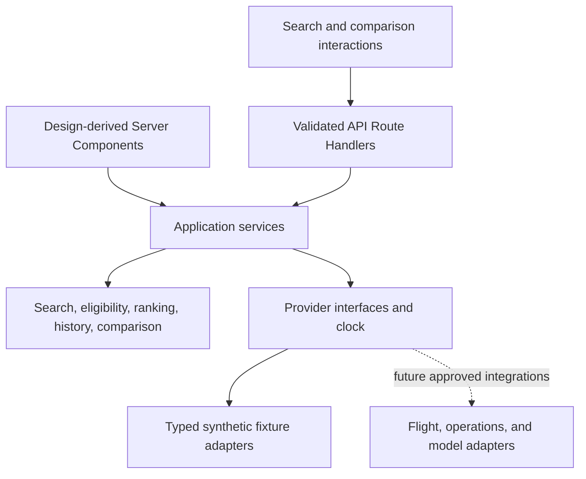
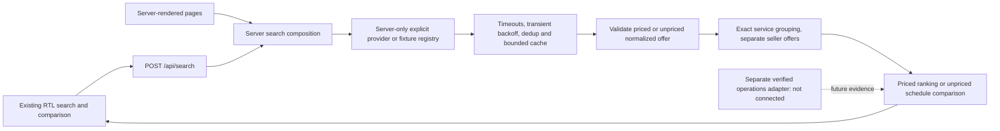

# Flight AI architecture

## Current metasearch architecture — 2026-10-17

This section supersedes lower historical checkout/ticketing architecture. The
Next.js application remains the existing search/comparison product; no alternate
server, provider transport or ranking algorithm is introduced.

- `FlightCard` and `ComparisonPanel` reuse `FlightDetails` for exact seller
  offers. The red purchase CTA is a native new-tab link, separate from optional
  in-memory round-trip planning. Following it does not mutate search/comparison
  state, close the details panel or write browser checkout/ticket state.
- `src/data/sellers.ts` holds official websites, verified flight-search URLs,
  exact approved hosts, stable seller aliases and evidence. The pure
  `src/domain/seller-destination.ts` resolver validates HTTPS, host and URL
  shape. Fixture URLs are ignored. Future booking-specific links additionally
  need explicit source-specific review; none is currently approved. No URL is
  inferred from an airport/date, seller name or opaque proposal identifier.
- Current destinations are public seller search entries. The presentation
  explicitly distinguishes continuation from a matching bookable flight/price.
  Unrecognized/unverified sellers are disabled, preserving other offer facts.
- Shared `JourneySelection`, validation and `journeyTotal` live in
  `src/domain/journey-selection.ts`; they preserve exact fares, chronology and
  canonical numeric rials for ranking and round-trip comparison. The renamed
  `useAssistantJourney` manages only in-memory outbound/inbound planning and
  existing pinned recommendations. There is no purchase submission.
- Deleted boundaries: passenger/contact/identity models and validators,
  checkout draft and ticket persistence, passenger/confirm/issued/My Tickets UI,
  three internal routes, ticket references and QR/PDF generation. Exclusive
  `html-to-image`, `jspdf`, `qrcode` and `@types/qrcode` dependencies are removed.
- Assistant preference persistence remains independent and unchanged. Legacy
  checkout/issued-ticket records are not read or written; no destructive cleanup
  is needed. Old routes naturally return 404. No unrelated storage is deleted.
- Provider adapters, source states, fixture/demo boundaries, pricing,
  historical-cancellation calculations, source attribution, AI model boundaries
  and styling remain intact. Seller referrals authorize no automated data
  collection, commercial feed or future booking endpoint.

See [METASEARCH.md](METASEARCH.md) for the full removed/modified file inventory,
verification and limitations, and [SELLER_DESTINATIONS.md](SELLER_DESTINATIONS.md)
for the reviewed URLs. The lower iteration notes retain historical context and
must not be read as currently implemented ticketing.


## Current AI Assistant runtime — 2026-10-16

[AI_ASSISTANT.md](AI_ASSISTANT.md) documents the additive `/ai-assistant` runtime,
typed contracts, full scoring policy, module inventory and verification. This
section supersedes lower historical statements that defer every model adapter.
The existing inventory provider, search, money, time, history and ticketing
implementations are reused without changing their policies.

- `domain/assistant-intent.ts` defines strict `TravelIntent`, nested
  `IntentPatch`, allowlisted confirmed paths and explicit clock/timezone/date
  bounds. Pure normalization separates ISO date-only values from instants and
  tagged input money from canonical rials; ambiguous values require questions.
- `/api/assistant/interpret` validates bounded untrusted input before the
  server-only OpenAI Responses transport. Strict structured output can propose
  preference changes only. Local validation authors messages, applies manual
  locks and handles clarification; no model prose becomes inventory evidence.
  Source mode is never supplied as a mutable model field.
- `/api/assistant/recommend` invokes the existing `executeSearch` through
  `application/assistant-recommendations.ts`. Hard constraints precede a separate
  deterministic eight-factor score. Unknown information stays neutral without
  favorable claims; correlated duration/stops weights are capped. One combined
  round-trip budget also constrains alternative seller fares.
- UI modules separately own conversation transport, editable preferences,
  recommendation display and exact journey selection. Abort/version guards
  reject stale responses; session persistence contains validated preferences and
  confirmed fields only. Existing FlightCard/ComparisonPanel/JourneySummary and
  `startCheckout` retain all details, history and issuance behavior.
- Both model environment variables are required; missing keys produce an honest
  unavailable result and leave manual deterministic recommendations operational.
  [AI_PROVIDER.md](AI_PROVIDER.md) records the fixed official destination, strict
  schema, request/response limits, deadline, privacy screen and local rate guard.
  These are local-demo controls, not distributed production abuse protection.

No SDK or other dependency was added. Combined lint/typecheck, 659 unit tests,
production build and all 137 browser tests pass. No real external model call
succeeded or was attempted without credentials; actual quality/access remains
unverified. No live fare provider or operational-history source was activated.

> **Latest presentation/navigation refinement (2026-10-16):** [UI-FUNCTIONAL-REFINEMENTS.md](UI-FUNCTIONAL-REFINEMENTS.md) records shared neutral badges, grouped comparison presentation, guarded airline identities/asset credits and responsive controls. The search-information disclosure is removed; actual provider/offer/history provenance and warnings remain. Checkout uses the existing `/checkout` route with a validated `step=confirm` history entry so completed-step and browser navigation preserve the session draft without allowing future-step bypass. Models, issued schema, providers, flight data, money and historical calculations remain unchanged. This note supersedes lower historical references to the removed notice and session-only progress UI.

## Current product evolution — 2026-10-16

The current runtime extends the existing architecture with [unified journey search and product flows](PRODUCT-EVOLUTION.md) and [local demonstration ticketing](LOCAL-TICKETING.md). This section supersedes lower historical descriptions of automatic initial inventory, one-way-only scope, temporary-only client state, no local issuance and source-navigation placement. Existing provider, search eligibility, currency, timezone, ranking and historical-cancellation policies are preserved.

- `src/domain/journey-search.ts` defines empty drafts, explicit field validation, trip type, per-direction query derivation and the submitted URL. `src/server/explorer-state.ts` returns an empty initial state without calling inventory for a bare `/`; only a complete valid query performs server search. Both `/` and compatible `/results` render the same explorer. Client submission updates the homepage query and calls the existing `/api/search`; editing a draft alone does neither.
- `FlightExplorer` keeps draft fields separate from submitted criteria. Outbound and reversed inbound requests execute independently in parallel. Each direction owns base/filtered responses, draft/applied filters, sort, error/loading state and request cancellation; comparison remains scoped to the active direction/context. New submissions reset incompatible comparisons and purchase selections. Existing deterministic fixtures already cover supported reverse domestic routes; no live fallback is introduced.
- `src/domain/booking.ts` reuses `Flight`/`SellerOffer` inside `JourneySelection`, typed passenger/contact drafts, `CheckoutDraft` and `DemoTicket`. Boundary parsers validate stored JSON, exact selected-offer membership, complete demo provenance, party count, route/segment chronology and canonical money. `journeyTotal` adds complete-party integer rials with overflow checks; it never multiplies the party twice or converts presentation units into storage.
- `src/lib/booking-storage.ts` writes in-progress checkout to `sessionStorage` and issued records to `localStorage`. `/checkout?selection=<UUID>` supports passenger entry/review; `/tickets/<reference>` displays and downloads the issued local record; `/my-tickets` reads the same store. Stable reference-derived keys make repeated issuance idempotent locally. Issued storage retains only masked identity suffixes, not full document numbers, birth dates or buyer contact. Invalid, missing and failed-storage paths remain explicit. No authentication backend, payment or airline transport is implied.
- Source-navigation handlers are removed from the shared header/footer. Legitimate provenance remains in the inline search disclosure and relevant seller/history/checkout/ticket presentations. Local QR generation encodes only the ticket URL/reference; the downloadable PDF renders the actual selected journey/passengers with an explicit invalid-for-travel demonstration status. See the ticketing document for schema, privacy, dependency and PDF limitations.

The current root `DESIGN.md` remains the sole visual authority. Earlier architecture examples and verification totals below are retained as historical planning/iteration records; final combined results are recorded in [PRODUCT-EVOLUTION.md](PRODUCT-EVOLUTION.md).

> **Current visual iteration:** The user-facing brand is ترب بلیط. The supplied reference screenshots and approved emblem drive the editorial hero, attached search navigation, two-column ticket cards, modal/bottom-sheet details and filters, discreet provenance, and complete footer. [UI-REDESIGN.md](UI-REDESIGN.md) records these authorized exceptions to older visual examples. Domain data, search/ranking, money and historical calculations remain unchanged.

> **Offline demo restoration (2026-10-15):** Pages, server search and omitted API mode default to the self-contained synthetic demo. Explicit live/reference modes preserve the existing adapter/aggregation architecture and never fall back or mix inventory. Dataset v4 adds deterministic domestic schedules for a continuous 2026-10-15–2036-12-31 horizon, sourced airline/aircraft reference metadata and optional `FlightSegment.aircraftModel`. The history reference stays fixed. [DEMO_RESTORATION.md](DEMO_RESTORATION.md) supersedes earlier default-provider and fixed-seven-date behavior.


Status: restored local MVP and offline-reference integration implemented; lint, typecheck, **364 unit tests across 13 files**, production Webpack build and **22 browser tests** pass (21.1 seconds for the browser run). [DEMO_RESTORATION.md](DEMO_RESTORATION.md) records current behavior. The initial 2026-10-15 repository inspection found only `.git` and no application, dependencies, or design source. The user has since authorized implementation and supplied `Design.md`. The current implementation iteration supersedes the previous documentation-only stop rule. Earlier code examples define planning contracts; current executable boundaries are described in the runtime section and passing local checks do not establish live-provider access.

## Current implementation iteration

Scaffolding, required local dependencies, domain/server implementation, and UI from the supplied reviewed design are now authorized. The design source is saved as `Design.md`; [DESIGN-INTEGRATION.md](DESIGN-INTEGRATION.md) records its integration decisions. The user's updated history thresholds are low below 10%, medium 10% to below 25%, and high at least 25%, replacing the old thresholds. At least 10 known outcomes and the existing verified-roster 80% coverage gate are both required. No paid APIs, real-model integration, booking, or public deployment is authorized.

The current authorized localization change adds Jalali presentation and Toman prices while preserving the existing design and domain behavior. [LOCALIZATION.md](LOCALIZATION.md) specifies the boundary: Gregorian ISO date-only values and UTC instants internally, canonical integer Iranian rials for arithmetic, Persian Jalali dates and Toman amounts in every user-facing view. This unit normalization does not introduce foreign-exchange conversion.

## 1. Architecture and boundaries

Use one Next.js App Router application with React, TypeScript, Tailwind CSS, server-side Route Handlers, and a framework-independent domain layer. Begin with typed local fixtures and no database, accounts, paid APIs, or real-model dependency.

Route Handlers translate validated HTTP requests into application-service calls; they do not own business rules. Next.js defines these endpoints through `app/**/route.ts`, using Web Request/Response APIs. [Next.js Route Handlers](https://nextjs.org/docs/app/getting-started/route-handlers).

Use Server Components for initial data and Client Components where interaction requires browser state, applying the supplied reviewed design. Keep provider adapters and future secrets server-only. [Next.js Server and Client Components](https://nextjs.org/docs/app/getting-started/server-and-client-components).

Server Components call application services directly rather than making HTTP requests to their own Route Handlers. Do not depend on process memory as durable session storage; the demo's comparison requests contain their complete context. A runtime-capable host is required for these APIs; static-only export is not the proposed deployment. [Next.js Backend for Frontend](https://nextjs.org/docs/app/guides/backend-for-frontend).



Dependency direction: presentation and routes depend on application services; services depend on domain contracts and provider interfaces; adapters implement those interfaces. Domain modules must not import Next.js, React, Tailwind, environment variables, network clients, or fixtures.

`Design.md` is the primary visual implementation authority. This architecture adds no replacement visual system. The user's green/amber/red/gray history meanings and Persian text labels are explicit semantic requirements and a narrow exception to the design's single accent rule; derive the rest of their presentation from the design and its documented integration decisions.

## 2. Scope and data mode

Current MVP: one-way economy, 1–9 adults, exact airports, non-stop or one connection, protected single-ticket journeys, Toman total-party price presentation backed by integer rials, Jalali date presentation, and comparison of two or three itineraries. See [PRD.md](PRD.md) for requirements and [ROADMAP.md](ROADMAP.md) for milestones.

The composition root defaults to the local `demo` generator without provider requests. Dataset `flight-ai-demo-v4-domestic-irr` has `asOf = 2026-10-15T12:00:00Z` and a continuous Gregorian ISO simulation horizon from 2026-10-15 through 2036-12-31; the older seven-date array contains examples only. The fixed history reference displays as ۲۳ مهر ۱۴۰۵ in the applicable fixture zones. Toman fares are authored synthetic values normalized into rials, not conversions of earlier USD fixtures at an assumed exchange rate. Airport and airline identities and conservative aircraft associations are factual reference metadata documented in [AIRLINE_REFERENCES.md](AIRLINE_REFERENCES.md); flight assignments, schedules, seller offers, availability, fares and operation outcomes remain synthetic. [DEMO_RESTORATION.md](DEMO_RESTORATION.md) records supported routes and deterministic generation.

Demo time never advances with the host clock. Dates outside the supported catalog are rejected with the supported range; a valid supported query with no flights produces an empty success response. Change the fixture version and its coherent search/history windows together when renewing the demo.

Every fare and history entity carries provenance; every response also identifies the data mode, reference instant, dataset version, ranking policy, and history policy. User-facing copy must say synthetic demo wherever a price or history insight can be read independently. The reference instant is not a live quote time. Future mixed-source results need explicit per-field/source disclosure; silent live-to-demo fallback is forbidden.

## 3. TypeScript domain contracts

These types form a contract example; the compact initial implementation mapping below permits simpler names while preserving the same behavioral invariants. String aliases describe validated formats; TypeScript alone cannot validate incoming JSON. Boundary schemas must enforce the constraints in this document. Future provider DTOs remain separate from these normalized types.

```ts
type Instant = string; // ISO 8601 UTC with Z; minute precision in MVP fixtures
type LocalDate = string; // validated Gregorian YYYY-MM-DD, date-only; display as Jalali
type AirportCode = string; // normalized three-letter airport identifier
type CarrierId = string; // stable internal ID; do not assume every carrier has an IATA code
type CurrencyCode = "IRR"; // ISO 4217; Toman is a display/input unit, not an invented currency code
type RiskLabel = "low" | "medium" | "high" | "unknown";

type Provenance =
  | { mode: "demo"; datasetId: string; asOf: Instant; label: string }
  | { mode: "live"; providerId: string; observedAt: Instant | null; label: string };

interface DemoMetadata {
  datasetId: string;
  asOf: Instant;
  supportedDepartureDates: LocalDate[];
  currency: CurrencyCode;
  disclosure: string;
}

interface Airport {
  code: AirportCode;
  name: string;
  city: string;
  countryCode: string;
  timeZone: string; // IANA identifier, never the browser's implicit zone
}

interface Airline { id: CarrierId; name: string; iataCode?: string; }
interface Seller { id: string; name: string; provenance: Provenance; }
interface PassengerParty { adults: number; children: 0; infants: 0; }
interface Money {
  currency: CurrencyCode;
  unit: "rial"; // canonical unit; normalize tagged Toman inputs exactly once
  amountRials: number; // nonnegative safe integer; 10 rials = 1 toman
}

interface OperationIdentity {
  operatingCarrierId: CarrierId;
  operatingFlightNumber: string;
  origin: AirportCode;
  destination: AirportCode;
  departurePattern?: { originalOriginLocalMinute: number }; // exact 0..1439 slot, only if needed
}

interface FlightSegment extends OperationIdentity {
  id: string;
  departureAt: Instant;
  arrivalAt: Instant;
  originLocalDepartureDate: LocalDate;
  provenance: Provenance;
}

interface Itinerary {
  id: string; // versioned canonical identity, not a provider ID
  segments: [FlightSegment, ...FlightSegment[]];
  durationMinutes: number; // first departure to final arrival, including connection
  stops: number; // segments.length - 1 in this MVP
  provenance: Provenance;
}

type BagAllowance =
  | { status: "known"; piecesPerAdult: number; maxKgPerPiece: number | null }
  | { status: "unknown" };

interface SegmentBaggage {
  segmentId: string;
  carryOn: BagAllowance;
  checked: BagAllowance;
}

interface SellerOffer {
  id: string;
  itineraryId: string;
  sellerId: string;
  providerReferences: { providerId: string; offerId: string }[];
  marketedSegments: { segmentId: string; carrierId: CarrierId; flightNumber: string }[];
  fareBrand: string;
  cabin: "economy";
  party: PassengerParty; // quote is normalized for precisely this party
  price: {
    adultBaseTotal: Money;
    mandatoryChargesTotal: Money;
    partyBookingFee: Money;
    total: Money;
    completeness: "complete" | "incomplete" | "unknown";
  };
  availability: "available" | "unavailable" | "unknown";
  ticketing: "single-ticket" | "self-transfer" | "unknown";
  baggage: SegmentBaggage[]; // complete segment mapping, per adult
  refundability: "refundable" | "non-refundable" | "unknown";
  changes: "allowed" | "not-allowed" | "unknown";
  terms: string[]; // unknown fees/conditions remain explicit
  expiresAt: Instant | null; // null is undisclosed, not indefinite validity
  provenance: Provenance;
}

interface SearchQuery {
  origin: AirportCode;
  destination: AirportCode;
  departureDate: LocalDate;
  party: PassengerParty;
  cabin: "economy";
  currency: CurrencyCode;
}

interface TimeWindow {
  startMinute: number; // 0..1439, inclusive, origin-local wall time
  endMinute: number; // 0..1439, exclusive; start > end crosses midnight
}

interface BagRequirement { piecesPerAdult: number; minKgPerPiece?: number; }

interface SearchFilters {
  operatingCarrierIds?: CarrierId[];
  sellerIds?: string[];
  maxStops?: 0 | 1;
  maxDurationMinutes?: number;
  maxLayoverMinutes?: number;
  maxPartyPrice?: Money;
  departureWindows?: TimeWindow[];
  requiredCarryOn?: BagRequirement;
  requiredCheckedBag?: BagRequirement;
  refundableOnly?: boolean;
  historyLabels?: RiskLabel[];
}

type RankingFactor = "price" | "duration" | "stops" | "schedule" | "baggage" | "history";
interface RankingPreferences {
  weights: Record<RankingFactor, number>;
  preferredDepartureWindows?: TimeWindow[];
  desiredCarryOn?: BagRequirement;
  desiredCheckedBag?: BagRequirement;
}

type SortKey = "recommended" | "price-asc" | "duration-asc" | "departure-asc" | "history-asc";
interface SearchRequest {
  query: SearchQuery;
  filters: SearchFilters;
  preferences: RankingPreferences;
  sort: SortKey;
}

interface HistoryWindow {
  startLocalDate: LocalDate; // inclusive
  endLocalDate: LocalDate; // exclusive: origin-local date of asOf
  originTimeZone: string;
  asOf: Instant;
}

interface ScheduledOperation extends OperationIdentity {
  operationId: string; // canonical roster ID, stable through schedule revisions
  originalScheduledDepartureAt: Instant;
  originalOriginLocalDate: LocalDate;
}

interface FlightOperation extends ScheduledOperation {
  outcome: "operated" | "cancelled" | "unknown";
  observedAt: Instant;
  revision: number | null;
  provenance: Provenance;
}

interface OperationsBatch {
  identity: OperationIdentity;
  window: HistoryWindow;
  roster: { verified: boolean; operations: ScheduledOperation[] };
  observations: FlightOperation[];
  provenance: Provenance;
  warnings: string[];
}

type UnknownHistoryReason =
  | "no-expected-operations" | "no-known-outcomes" | "insufficient-sample"
  | "unverified-roster" | "low-coverage" | "invalid-matching-data" | "history-unavailable";

type HistoryCategory =
  | { status: "sufficient"; label: "low" | "medium" | "high" }
  | { status: "unknown"; label: "unknown"; reasons: UnknownHistoryReason[] };

interface CancellationHistory {
  segmentId: string;
  identity: OperationIdentity;
  window: HistoryWindow;
  expectedCount: number | null; // null unless roster is verified
  operatedCount: number | null; // null when unavailable, never fabricated zero
  cancelledCount: number | null;
  unknownCount: number | null; // roster rows with unresolved/conflicting observations
  missingCount: number | null; // roster rows without any usable observation
  conflictingCount: number | null; // subset of unknownCount, never added twice
  knownCount: number | null;
  coverage: number | null; // fraction 0..1
  cancellationRate: number | null; // headline: cancelled / known only if sufficient
  observedRate: number | null; // cancelled / known; diagnostic if insufficient
  category: HistoryCategory;
  policyVersion: string;
  provenance: Provenance;
  lastUpdatedAt: Instant | null; // demo: provenance.asOf, not a live refresh
  warnings: string[];
}

interface ItineraryHistory {
  legs: CancellationHistory[];
  summaryLabel: RiskLabel; // no overall cancellation-rate/probability field
}

interface RecommendationScore {
  value: number; // 0..100 preference utility, not probability
  policyVersion: string;
  components: {
    factor: RankingFactor;
    utility: number; // 0..1
    normalizedWeight: number;
    contribution: number;
    explanation: string;
  }[];
  tradeoffs: string[];
}

interface OfferEvaluation {
  offer: SellerOffer;
  eligible: boolean;
  exclusionReasons: string[];
  score: RecommendationScore | null;
}

interface FlightResult {
  itinerary: Itinerary;
  offers: OfferEvaluation[];
  representativeOfferId: string;
  cheapestEligibleOfferId: string;
  representativeBasis: "best-fit" | "cheapest-eligible";
  history: ItineraryHistory;
  recommendation: RecommendationScore; // score of representative offer
}

interface PreferenceInterpretation {
  engine: "demo-rules" | "model";
  disclosure: string;
  proposedFilters: SearchFilters;
  proposedPreferences: RankingPreferences;
  recognized: { text: string; field: string; valueDescription: string }[];
  issues: { kind: "unsupported" | "ambiguous" | "conflict"; text: string; message: string }[];
  requiresUserReview: true;
}

interface ComparisonSelection { itineraryId: string; offerId: string; }
interface ComparisonRequest {
  context: SearchRequest;
  expectedContextId: string; // fingerprint returned by the originating search
  selections: [ComparisonSelection, ComparisonSelection, ...ComparisonSelection[]];
}
interface ComparisonEntry {
  itinerary: Itinerary;
  selectedOffer: SellerOffer;
  selectedOfferScore: RecommendationScore;
  history: ItineraryHistory;
}
interface ComparisonResult {
  contextId: string;
  entries: ComparisonEntry[];
  selections: ComparisonSelection[];
}

interface FlightInventory {
  itineraries: Itinerary[];
  offers: SellerOffer[];
  provenance: Provenance;
  warnings: string[];
}
interface FlightSearchProvider { search(query: SearchQuery): Promise<FlightInventory>; }
interface OperationsHistoryProvider {
  load(identity: OperationIdentity, window: HistoryWindow): Promise<OperationsBatch>;
}
interface PreferenceInterpreter {
  interpret(text: string, context: SearchRequest): Promise<PreferenceInterpretation>;
}
interface Clock { now(): Instant; }

interface ResponseMetadata {
  mode: "demo" | "live";
  asOf: Instant;
  datasetId: string | null;
  contextId: string | null;
  rankingPolicyVersion: string;
  historyPolicyVersion: string;
  disclosure: string;
  warnings: string[];
}
interface ApiError {
  code: string;
  message: string;
  fields?: { field: string; message: string }[];
}
type ApiResponse<T> =
  | { ok: true; data: T; meta: ResponseMetadata }
  | { ok: false; error: ApiError; meta: ResponseMetadata };
```

### Compact initial implementation mapping

The initial local implementation may use these smaller contracts instead of reproducing every proposed field above. Preserve behavior and add missing provider detail before integrating real data:

| Initial type/field | Contract meaning |
| --- | --- |
| `FlightIdentity { airlineId, flightNumber, origin, destination }` | Operating carrier/number/route identity; these are not marketing codeshares. Optional original-departure-minute discrimination is explicit matching configuration when needed. |
| `FlightSegment` with `id`, `airlineName`, `departureAt`, `arrivalAt` | A scheduled operating segment; airport metadata supplies IANA zones and origin-local dates. |
| `Flight { id, segments, durationMinutes, stops, offers, history? }` | The scheduled `Itinerary` plus normalized attached offers and per-leg `CancellationHistory[]`. Grouping still uses exact ordered physical segment keys. |
| `FlightSearchInput { origin, destination, departureDate, adults, currency: "IRR" }` | The structured query/party basis; `departureDate` is Gregorian ISO despite Jalali UI. Filters, preferences, and sort remain separately validated search context. |
| `SellerOffer.flightId`, `adults`, `totalPrice: Money` | `itineraryId`, party match, and canonical integer-rial total quote. Seller, fare name, refundability, price completeness, availability, and ticketing remain offer-level facts. |
| `SearchFilters.maxPriceRials` | Complete party budget as a nonnegative safe integer in rials; the UI accepts Toman and converts once before submitting. Old `maxPriceMinor` is rejected. |
| Shared Jalali/date-only utilities and `domain/time.ts` | Convert selected Persian calendar fields to ISO date-only values; format dates and explicitly zoned timestamps in Jalali. The existing Temporal polyfill supplies calendar conversion without another date library. |
| `domain/money.ts` | `toRialMoney` normalizes explicitly tagged rial/Toman source values; `parseTomanInput` normalizes Persian user budgets; `formatToman` supplies lossless Persian display. No UI owns another conversion. |
| `SegmentBaggage { segmentId, checkedKg: number \| null, carryOnKg: number \| null }` | Known included per-adult kilogram allowances per segment, with null preserving unknown. The compact fixture convention is one included bag when its known allowance is positive, zero bags at zero, and unknown at null. Multiple-piece conditions, paid extras, and provider quote-charge breakdowns require richer types; never infer them. |
| `CancellationHistory.cancellationRate` | Card/main percentage fraction, null whenever evidence is insufficient or unavailable. `observedRate` is separately retained only for available-outcome diagnostics in expanded detail. Counts, window, category, reasons, and provenance remain explicit. |
| `source: DataSource` plus `CancellationHistory.asOf` | Split representation of provenance: mode/source identity/label and fixed reference instant. The demo UI may derive its synthetic last-update display directly from `asOf`, without a duplicate stored `lastUpdatedAt` field. |

Full provider references, marketed flight identities, richer bag-piece conditions, and detailed quote components are future schema expansion points. Do not imply a compact field supplies absent information. Search, detail, comparison, and UI must call the same normalized services; no duplicate calculations are permitted.

### Required invariants

- Money is a nonnegative safe integer number of Iranian rials with explicit `currency: "IRR"` and `unit: "rial"`. All quote components use this canonical unit and sum exactly to the party total. Check for overflow; never sort formatted strings or floating-point currency values. `toRialMoney({ unit: "rial", amount })` preserves rials; `unit: "toman"` converts once by multiplying by ten, rejecting fractional rials or unsafe results. `formatToman` uses integer quotient/remainder division by ten and Persian grouping, preserving a one-rial remainder as one decimal digit. No FX conversion is proposed.
- Demo quote templates may contain per-adult base, per-adult mandatory charges, and one party booking fee. Normalize as `total = adults * (unitBase + unitMandatoryCharges) + partyBookingFee`. This is a demo pricing rule, not an assumption for real provider pricing.
- Party count is an integer 1–9, children/infants are zero, and every quote matches the requested party/cabin. Fixtures state capacity; a template unable to serve the complete party cannot yield an available quote.
- Itineraries have one or two chronological segments. Adjacent airports match; every arrival follows departure; connection duration is positive. Only a fixture-declared protected single ticket is eligible. The MVP does not construct connections from unrelated flights or claim legal minimum connection times.
- Duration is elapsed minutes between UTC instants, including layover, not a subtraction of displayed local clocks. Fixture timestamps are minute-aligned. Derive stops and duration, validate any stored copies, and disclose arrival-day changes.
- `LocalDate` is a Gregorian ISO date-only value, never an instant. Use Temporal `PlainDate` with the Persian calendar for Jalali conversion and month/year arithmetic; convert back to ISO before API/search/storage. Format date-only values without an implicit browser/server zone. For an `Instant`, first apply the relevant airport/source IANA zone, then format its local date in Jalali. Calendar display must not change origin-local history windows or UTC durations. See [Temporal PlainDate](https://tc39.es/proposal-temporal/docs/plaindate.html).
- Baggage maps each segment exactly once and applies per adult. Known zero bags differs from unknown. A known piece count with unknown weight can satisfy a piece-only requirement, but cannot satisfy a requested minimum weight. No unspecified personal-item allowance or paid-bag price is invented.
- Evaluate each baggage requirement as satisfied, insufficient, or unknown: too few known pieces is insufficient; enough pieces with undisclosed weight is unknown when a minimum weight is requested. Hard constraints require satisfied; soft scoring uses the corresponding tri-state utility.
- Provider references remain separate from canonical IDs. Marketing carrier labels can vary by offer; physical identity and history matching use operating identifiers.
- Runtime validation rejects malformed dates/instants, unsupported identifiers, invalid windows, negative amounts/weights, unknown enum values, duplicate references, cross-dataset links, and inconsistent schedules. An invalid fixture fails validation, rather than being silently repaired at presentation time.

## 4. Canonical identity and search

1. Validate and normalize the structured query. Match origin/destination exactly and derive the first departure's date in the origin airport's IANA zone. Search does not infer nearby airports, route changes, or flexible dates.
2. Load candidates through `FlightSearchProvider`. In demo mode, restrict them to the fixed manifest; a provider returns normalized party quotes rather than browser-calculated prices.
3. Define a physical segment key from operating carrier ID, normalized operating flight number, origin, destination, departure UTC instant, and arrival UTC instant. Define an itinerary key from the ordered segment keys. Use versioned canonical serialization and a deterministic ID; guard against collisions. Provider IDs are mapping evidence, not the sole cross-provider key.
4. Normalization trims case/spacing and removes the already identified carrier prefix from a separate flight-number field, while preserving meaningful suffixes and source values in adapter mappings. Do not use fuzzy departure-time windows. If operating identity or schedules disagree, keep candidates separate and report unresolved identity. A future schedule correction can create a new scheduled-itinerary ID; history operation IDs remain stable across that correction.
5. Group seller offers under the exact itinerary ID. Distinct fare brands, baggage terms, ticketing protection, or conditions remain separate offers even from the same seller. Deduplicate only a proven repeated quote identity/revision, never simply seller name and price.
6. Compute leg history once per matching service/window and derive itinerary history. Apply flight-level constraints (duration, stops, operating airlines, departure windows, layovers, history category), then offer-level constraints (seller, complete price, budget, party, ticketing, baggage, refundability).
7. An itinerary survives only when at least one offer independently satisfies every hard requirement. `maxPartyPrice` includes the complete party total and uses the same currency. Baggage requirements must hold on every segment. Airline filtering requires each segment's operating carrier to be in the selected set. Unknown refundability/baggage does not pass an affirmative hard constraint.
8. Available complete offers are eligible; unavailable, unknown-availability, incomplete-price, mismatched-party, self-transfer, and unknown-ticketing offers are excluded with reasons. Compare known expiry against the source's reference clock. In the synthetic MVP, absent expiry means no expiry rule is modeled, and never proves real validity.
9. Departure windows use the first origin's local wall time. Multiple windows combine with OR; other constraints combine with AND. A crossing-midnight window accepts times at or after its start or before its end. Equal endpoints and empty selected arrays are invalid; omitting a field means no constraint. Upper price/duration/stops limits are inclusive. History filters use the summary label, so unknown is included only when explicitly selected.
10. Rank eligible offers, select a representative per itinerary, sort deterministically, and return explanations and metadata. Include excluded alternatives with reasons in detailed offer evaluation; never call an excluded offer the cheapest eligible offer.

The initial fixture inventory is bounded (target no more than 50 matching itineraries per query), so return the complete result set without pagination. Server-side filtering and ranking remain authoritative. Request fingerprints include canonical query, filters, preferences, sort, data snapshot/dataset version, and policy versions. Future live snapshots must also identify normalized offer/history revisions or content, so a fare change cannot preserve the old fingerprint. A `contextId` is a reproducibility identifier, not an authorization token or server session.

## 5. Ranking and recommendation policy v1

Recommendations optimize stated preference utility. Hard constraints always run first. No model invents prices, schedules, historical outcomes, scores, or explanations.

| Factor | Default weight | Utility in the synthetic IRR/Toman MVP |
| --- | ---: | --- |
| Price | 35 | `1 / (1 + totalPartyRials / (125000000 * adults))`; fixed ۱۲٬۵۰۰٬۰۰۰ Toman/adult reference stored as ۱۲۵٬۰۰۰٬۰۰۰ rials |
| Elapsed duration | 25 | `1 / (1 + durationMinutes / 360)` |
| Stops | 15 | Non-stop: `1`; one connection: `0.4` |
| Preferred departure time | 10 | Inside any preferred window: `1`; otherwise `max(0, 1 - circularDistanceMinutes / 360)` |
| Desired included baggage | 5 | Per requested allowance type: known sufficient `1`, unknown `0.5`, known insufficient `0`; use worst leg, then mean across requested types |
| Historical insight | 10 | Per leg: low `1`, medium `0.5`, high `0`, unknown `0.5`; use minimum across legs |

Time and baggage dimensions are inactive if no corresponding soft preference is supplied. Zero weights disable dimensions. Weights are finite numbers 0–100; at least one active dimension must have positive weight. Normalize active weights once for the query, identically for every candidate. A budget or baggage filter does not automatically become a soft preference.

For wall-time distance, take the shortest distance around the 24-hour clock to the accepted interval; an exclusive end has an infimum distance of zero, even though its exact endpoint fails a hard window filter. This continuous soft utility and discrete hard eligibility are intentional. No min/max normalization against the currently visible candidates is used, so removing an unrelated candidate does not change another's score.

`score = 100 * sum(normalizedWeight * utility)`. Use full precision for ordering; round only for display. The ranking references, weights, and history contribution are configurable product heuristics, not empirically calibrated measures of quality, reliability, or future cancellation probability. Unknown history receives a neutral utility contribution, never a zero cancellation rate or a medium history label. If a connected trip has a known high-history leg and an unknown leg, its label remains unknown but the known adverse leg still contributes utility zero.

Recommended chooses the highest-score eligible offer per itinerary; ties choose lower party total, then stable offer ID. Itinerary ties use score descending, representative total ascending, duration ascending, stops ascending, itinerary ID ascending. These rules are independent of provider response order.

For `cheapestEligibleOfferId` and `price-asc`, select offers by party total ascending, score descending, stable offer ID ascending. Then sort itinerary representatives by party total, score descending, duration, and ID. `duration-asc` and `departure-asc` retain the best-fit eligible offer and sort first by their named value, then score descending, price, and ID. `history-asc` retains the best-fit offer and sorts sufficient historical fractions ascending, with unknown last, then score descending, price, and ID. For connections, use the maximum sufficient leg fraction as an ordering key only when all legs are sufficient; it is the worst-leg observed fraction, never an overall journey rate. Ranking's historical utility continues to use categories rather than rewarding tiny fraction differences.

The explanation comes from actual component values and the actual representative offer. State the selected price/party basis, favorable factors, material compromises, missing evidence, and active sort. Relative comparisons may name a cheaper/faster eligible alternative only when computed from this same result set. Do not claim that a recommendation is safest, will operate, or is statistically more reliable. Templates supply factual demo explanations; a future language model may verbalize validated evidence but cannot replace scoring. Per-leg historical counts, sufficient rates, categories, and unknown reasons remain typed future AI-ranking inputs with retrospective semantics, never calibrated forecasts.

All displayed explanation prices use `formatToman`, while scoring and sort tie-breaking use `amountRials`. The localized policy is `ranking-v2-irr`; weights and historical evidence semantics remain unchanged. The new synthetic fare scale and its fixed rial reference are authored demo choices, not a foreign-exchange model.

## 6. Cancellation-history algorithm v2

### Window and matching

For each leg, derive `anchorDate` from `asOf` in that leg's origin zone. The window is `[anchorDate - 30 calendar days, anchorDate)`. Include by **original scheduled origin-local departure date**, never actual departure time or arrival date. The whole current origin-local day is excluded, even when some flights have finished. The searched departure date does not move the history window into the future.

For an origin where the fixed reference instant falls on 2026-10-15, this covers 2026-09-15 through 2026-10-14 inclusive. Compute each leg independently. Use calendar-aware zoned arithmetic rather than subtracting `30 * 24 hours`; local days and start-of-day can vary at zone transitions. [TC39 Temporal ZonedDateTime documentation](https://tc39.es/proposal-temporal/docs/zoneddatetime.html).

These ISO examples describe the internal contract. User-facing history periods and source updates format as Jalali with Persian month names/numerals in the same explicit origin zone; the conversion does not alter endpoints, the denominator, or the 30 completed-day policy.

Match the exact operating carrier, normalized operating flight number, origin, and destination. Do not pool another flight number, the reverse route, marketing codeshares, or an airline-wide rate when matching history is absent. If a future provider lacks exact operating identifiers, that leg is unknown pending a validated mapping.

If these identifiers are reused for distinct scheduled departure cohorts, a fixture/provider may explicitly supply `departurePattern.originalOriginLocalMinute`. It is an integer 0–1439 from the **original** scheduled departure in the origin zone, and matches that minute exactly; it is not a fuzzy time window, inferred morning/evening group, or revised actual departure. Without that discriminator, all exact identity/route operations in the window are included. Canonical operation IDs still distinguish separate same-day services.

### Reconciliation and evidence sufficiency

1. Obtain the authoritative scheduled-operation roster for the identity and window as known by `asOf`, using the same knowledge cutoff as outcome records. The roster must be verified as complete for expected operations, independently of how many outcome rows were received. No assumed daily frequency and no `expected = observations.length` fallback.
2. Resolve records to the roster's stable canonical operation ID. A fallback key uses exact service identity plus original scheduled departure instant; a local date alone is insufficient for repeated same-day services. Never create an extra operation for a schedule revision or codeshare observation.
3. Ignore revisions observed after `asOf`. Prefer the latest authoritative revision observed by `asOf`; resolve equal-revision conflicts or uncertain identity as unknown. If the source supplies no revision number, use latest authoritative `observedAt`, with equal-time conflicting outcomes unknown. Mixed revision semantics require an explicit adapter rule rather than a guess. Future multi-provider reconciliation needs explicit source priority/mappings rather than counting providers as additional flights.
4. With a verified roster, join deduplicated observations to roster operations. An absent observation is missing; an unresolved/conflicting observation is unknown. With an unverified roster, compute lower-bound diagnostics from deduplicated, exact-matching observations in the window instead; do not discard them merely because an incomplete roster lacks their rows. Expected count, missing count, and coverage remain null, and the category remains unknown. Delayed flights that operated and confirmed diversions count as operated. A removal with no confirmed cancellation outcome remains unresolved; only explicit final cancellation counts as cancelled. The original scheduled roster retains confirmed cancellations.
5. Let `C` be cancelled, `O` operated, `N = C + O`, and `E` verified expected operations. Verified-roster invariants are `E = N + unknown + missing` and `N <= E`; conflicting is a subset of unknown. Reject inconsistent batches as unknown rather than clipping counts. An exact-matching, in-window observation absent from a declared complete roster contradicts completeness: invalidate sufficiency, set expected/missing/coverage to null, preserve valid diagnostic counts, and report invalid matching data. Records outside the identity/window are excluded without implying such a contradiction.
6. Set diagnostic `observedRate = C / N` if `N > 0`, otherwise null. Set `coverage = N / E` only when `E > 0` and the roster is verified. The user's minimum sample is 10 known historical outcomes. Retain the existing verified-roster 80% coverage gate as an additional requirement: sufficiency requires a valid batch, `E > 0`, `N >= 10`, and `coverage >= 0.80`. Set headline `cancellationRate = observedRate` only when sufficient; otherwise null.
7. Insufficient evidence yields gray/unknown with reason codes, counts, and any valid detail-only diagnostic observed fraction. Every card's unknown headline shows `—` with `داده ناکافی` for deficient sample/coverage or `نامشخص` for unavailable/unverified/invalid evidence, never `0%`. If expanded detail exposes `observedRate`, describe it as cancellations among available known outcomes with insufficiency attached. With an unverified roster, observed terminal counts are lower-bound diagnostics and expected/missing/coverage remain null. A failed history load uses `history-unavailable`, null counts/rates/coverage, and an unavailable source observation time; zero is reserved for an actually measured count. Invalid counts are never exposed as trusted diagnostics.
8. The user's updated thresholds replace the previous policy. Classify the unrounded sufficient fraction: green/low `کم` when `< 0.10`, amber/medium `متوسط` when `>= 0.10 && < 0.25`, red/high `زیاد` when `>= 0.25`. Compare using integer ratios/cross multiplication where practical. Rounding the displayed percentage must not change the category. Every flight card visibly includes that percentage and Persian label.

| Evidence example | Outcome |
| --- | --- |
| 0 cancelled, 30 operated, 30 expected | 0/30 = 0%; low; this does not prove future operation |
| 1 cancelled, 29 operated, 30 expected | 1/30 = 3.33%; low / `کم` |
| 3 cancelled, 27 operated, 30 expected | 3/30 = 10%; medium / `متوسط` |
| 5 cancelled, 15 operated, 20 expected | 5/20 = 25%; high / `زیاد` |
| 0 cancelled, 8 operated, 8 expected | Unknown: sample below 10, despite complete coverage |
| 0 cancelled, 12 operated, 20 expected | Unknown: 60% coverage |
| 30 known outcomes, no verified expected roster | Unknown: coverage cannot be established |

These thresholds and the sample minimum follow the latest user instruction; verified-roster coverage is a retained additional evidence gate. They do not correct selection bias or establish a calibrated forecast. An accessible popover/dialog shows cancelled count, total known historical flights `N`, expected count `E`, unknown/missing counts, coverage, the exact window, source, last update, and the retrospective limitation. In demo mode `lastUpdatedAt` is the synthetic `provenance.asOf` reference instant, labeled accordingly; it is not a real refresh. Live adapters may later supply an actual observed source update time, preserving null when unavailable. The status colors are a semantic exception to the supplied design's single accent rule; text and keyboard access are mandatory.

For a connection, keep each leg's counts, percentage, window, and Persian category visible separately. If all legs are sufficient, summarize the worst category with order low < medium < high; otherwise the itinerary summary is unknown, alongside all known leg evidence. There is no overall journey percentage. Do not average/sum rates, pool denominators, assume independence, or create an itinerary cancellation probability.

## 7. Natural-language preference interpretation

The seven-day demo uses `DemoPreferenceInterpreter`, a deterministic phrase parser. It is explicitly **simulated demo interpretation**, not an LLM or proof of true AI capability. Both supported phrases and fixture outputs must be tested. A future model implementation uses the same interface and server validation; vendor, cost, privacy terms, and credentials are unselected.

Structured origin, destination, date, passenger count, and currency remain authoritative. Interpretation proposes filters/preferences only. Phrases that would alter these search fields are returned as unsupported guidance. The result never auto-applies: users review recognized fields and unresolved issues, accept a conflict-free proposal or edit constraints, then submit a new validated search.

Distinguish hard constraints ("non-stop only", "at most ۱۰٬۰۰۰٬۰۰۰ تومان total", "must include a checked bag") from soft priorities ("prefer non-stop", "shorter journey", "prefer morning departure"). Example demo mappings can explicitly propose morning as 06:00–12:00 local, a checked-bag requirement as one piece per adult with unspecified weight, and prioritize a named criterion by doubling its default weight once. Recognized mappings are shown for acceptance; ambiguous monetary units or total/per-adult basis require clarification before adding a budget. An explicit per-adult Toman cap can be normalized to rials and multiplied by adults with overflow checks, preserving the original wording in the review. Other currencies require a separately approved FX policy; never reinterpret a dollar amount as Toman.

"Reliable", "safe", and "won't cancel" cannot become promised reliability or future probability filters. They produce a clarification/unsupported issue unless the user explicitly asks for observed historical cancellation categories. Unrecognized or contradictory text remains visible; no guessed hidden constraint is applied. Merge proposals against the current structured request with explicit conflict reporting, including impossible windows, mismatched currencies, and incompatible constraints. Do not silently relax a user's existing requirements.

Bound input to 1,000 characters and JSON request size to 16 KiB. Treat text as data, never code, HTML, SQL, a URL to fetch, or authority to call tools. A future model returns only allowlisted structured suggestions, which must pass runtime schemas; invalid output/failure keeps the previous request intact and preserves manual controls. Never silently switch a failed real-model interpretation to a simulation. No fabricated confidence values or model-generated fare/history facts.

## 8. Comparison and detail logic

Comparison contains two or three unique itinerary selections from one validated `SearchRequest`, including an explicit seller `offerId` for each. Selection state can hold one itinerary while the user builds a comparison, but the comparison API requires two. A fourth selection prompts replacement through the approved interaction design.

The server reruns the common context and verifies itinerary membership, offer membership, eligibility, party, currency, and dataset/policy version. Compare the submitted `expectedContextId` with the rerun fingerprint; return `STALE_CONTEXT` when the data or policy changed, so the user can review updated results rather than receiving silently changed selected fares. The fingerprint is not trusted as authority for prices/scores/history. Changing route, date, or party clears comparison selection; changing filters/preferences first obtains a new search fingerprint, then revalidates selections and explicitly identifies any now-ineligible offer. No silent replacement with another seller's fare.

Compare party totals and charge components, cabin/fare brand, refund/change conditions, every-leg baggage, departure/arrival/date context, duration/stops/layovers, operating and marketing identity, preference components, and leg-level history. Each `ComparisonEntry` carries the selected offer and its own score, even when it differs from the search's representative offer. Preserve null/unknown information. The lowest-price marker uses the selected complete quotes; it does not imply equal fare benefits. No price-per-kilogram or combined journey risk is calculated.

Details reuse the same service output and chosen party basis. Seller alternatives remain distinct. A price from one offer cannot satisfy the baggage or refundability constraint of another. The initial demo has no real checkout links or booking action.

## 9. Proposed HTTP contracts

All routes use runtime schemas, the typed response envelope above, and stable error codes. The server fills default preferences; the client may send validated user changes. Search responses include normalized context, flight results, eligible count, and applied interpretation-independent warnings. Detail and comparison responses preserve context and source metadata.

The implemented localized request contract uses `query.currency: "IRR"`, Gregorian ISO `query.departureDate`, and numeric `filters.maxPriceRials`. Responses carry `Money { currency: "IRR", unit: "rial", amountRials }`; supported-date machine fields remain ISO. Human-readable unsupported-date messages are Jalali. This is an explicit demo API migration: old USD requests, `amountMinor`, and `maxPriceMinor` are not silently reinterpreted as rials/Toman. Provider normalization must state the incoming unit. [LOCALIZATION.md](LOCALIZATION.md) documents examples and boundaries.

| Endpoint | Request | Response |
| --- | --- | --- |
| `GET /api/demo` | None | `DemoMetadata`, supported airport/route inventory, disclosure |
| `GET /api/airports?q=...` | Optional bounded airport-name/code text | Airport reference records; no location inference |
| `POST /api/search` | `SearchRequest` | Normalized context and `FlightResult[]` |
| `POST /api/preferences/interpret` | `{ text, context: SearchRequest }` | `PreferenceInterpretation`; no search mutation |
| `POST /api/flights/[itineraryId]` | `{ context: SearchRequest, expectedContextId: string }` | Details from the same eligibility/quote/history services; stale-check the search fingerprint |
| `POST /api/compare` | `ComparisonRequest` | `ComparisonResult` preserving selected seller offers |

Search/detail/compare are read operations transported as POST to carry validated structured context without storing free text in URLs. No API session, database writes, or provider requests occur in demo mode. Set `Cache-Control: no-store` explicitly on these responses and interpretation; do not depend on framework cache defaults. Fixture loading may reuse immutable versioned module data, while request results and selections remain stateless.

| Status/code | Meaning |
| --- | --- |
| `200`, empty results | Valid supported query has no eligible flights; optional exclusion summary |
| `400 INVALID_REQUEST` | Malformed JSON, schema failure, invalid airport/date/party/weights |
| `413 REQUEST_TOO_LARGE` | JSON payload exceeds the bound |
| `415 UNSUPPORTED_CONTENT_TYPE` | POST body is not JSON |
| `409 STALE_CONTEXT` | Data snapshot or policy differs from the submitted search fingerprint; request a new search/review |
| `422 UNSUPPORTED_DEMO_DATE` | Valid calendar date outside fixture manifest; include supported dates |
| `422 INVALID_COMPARISON` / `INELIGIBLE_SELECTION` | Wrong selection count, duplicates, incompatible context, ineligible seller offer |
| `404 ITINERARY_NOT_FOUND` | Unknown ID or itinerary outside requested context |
| `429 RATE_LIMITED` | Future public host request limits are reached |
| `503 PROVIDER_UNAVAILABLE` | Future provider unavailable; never substitute unlabeled demo data |
| `500 DATA_INTEGRITY_ERROR` / `INTERNAL_ERROR` | Invalid flight/offer fixtures or unexpected failure; sanitized message and request ID |

A valid flight result can survive a history-provider failure or invalid history batch with history unknown and an explicit warning; fixture validation still flags malformed history for repair. A fare-provider failure does not become an empty successful flight search. Preference ambiguities/conflicts are successful interpretation results with issues, not silently accepted constraints.

Keep raw preference text, passenger personal data, credentials, and provider payloads out of logs. The MVP requires no passenger identities. Future public deployment will need bounded workloads, provider timeouts, request IDs, server-side credential isolation, and host-compatible rate limits; no process-memory limiter is assumed to work across distributed instances.

## 10. Proposed project structure

This tree is the implementation target, with compact domain naming permitted by the mapping above. Authorized scaffolding may create these directories as needed; avoid empty abstractions. `Design.md` is the supplied source, preserved rather than generated.

```text
Flight/
  AGENTS.md
  Design.md                         # supplied visual authority, reviewed
  docs/
    PRD.md
    ARCHITECTURE.md
    ROADMAP.md
    DESIGN-INTEGRATION.md            # source contradictions and integration decisions
    LOCALIZATION.md                  # Jalali presentation and rial/Toman boundaries
  src/
    app/
      api/
        demo/route.ts
        airports/route.ts
        search/route.ts
        preferences/interpret/route.ts
        flights/[itineraryId]/route.ts
        compare/route.ts
      layout.tsx                    # derives from the supplied reviewed design
      page.tsx                      # search experience
      results/page.tsx
      flights/[itineraryId]/page.tsx
      compare/page.tsx
      globals.css                   # design-derived Tailwind/tokens
    components/                     # design-approved reusable presentation
    features/
      search/                       # search interactions and request state
      offers/                       # seller selection and details
      preferences/                  # interpretation review and manual controls
      comparison/                   # selected itinerary/offer state
    domain/
      models.ts
      money.ts
      time.ts
      jalali.ts                     # ISO date-only/Persian calendar conversion and formatting
      numerals.ts                   # Persian/Arabic/Latin digit normalization
      identity.ts
      eligibility.ts
      search.ts
      ranking.ts
      explanations.ts
      cancellation-history.ts
      comparison.ts
      policies.ts                   # versioned defaults and thresholds
    application/
      search-service.ts
      detail-service.ts
      comparison-service.ts
      preference-service.ts
    providers/
      contracts.ts
      demo/
        flight-provider.ts
        operations-provider.ts
        preference-interpreter.ts
    fixtures/
      demo-metadata.ts
      airports.ts
      airlines.ts
      sellers.ts
      itineraries.ts
      offer-templates.ts
      scheduled-operations.ts
      operation-outcomes.ts
      validate.ts
    server/
      composition.ts                # server-only provider wiring
      schemas.ts                    # runtime validation
      responses.ts
      clock.ts
    lib/
      formatting.ts                 # display formatting, no ranking logic
  tests/
    domain/                         # meaningful invariants and boundary cases
    api/                            # schema/contract/selection behavior
    e2e/                            # a small set of critical user journeys
  public/                           # design-approved local assets
  package.json                      # authorized local tooling
  tsconfig.json
  next.config.ts
```

Feature modules own interactions, domain modules own rules, application services coordinate ports, and adapters own normalization. Avoid global state libraries and shared-component abstractions until an actual need is established. Compare state is temporary; route/date/party and structured filters can be shareable URL state after design review, while natural-language text is not added to the URL.

## 11. Technical decisions, dependencies, and risks

| Decision/dependency | Rationale or risk | Proposed response |
| --- | --- | --- |
| One application with App Router APIs | Keeps MVP integration simple; deployment must support server runtime | Share services between Route Handlers and Server Components; no separate backend service yet |
| Strict TypeScript plus runtime schemas | Types do not validate network/provider data | Small boundary-validation dependency or equivalent explicit validators selected during authorized scaffolding |
| Integer rial money, explicit currency/unit and party | Prevents hidden per-person comparisons, double conversion, and floating-point errors | Canonical `IRR`/rial totals, exact Persian Toman display, tagged normalization, safe-range checks; no FX; preserve provider fare/charge completeness |
| Jalali presentation and time-zone-aware calendar utility | Gregorian/Jalali and month/leap boundaries plus DST or implicit zones can corrupt dates | Reuse installed Temporal polyfill with Persian `PlainDate`; Gregorian ISO date-only boundaries and explicit IANA zones; no additional calendar dependency |
| Typed fixtures and fixed reference clock | A moving calendar can make demos inconsistent | Version manifest, identity, fares, expected roster, and outcomes together |
| Local simulated interpreter | Bounded demo vocabulary does not satisfy general model capability | Explicit simulation disclosure, reviewed suggestions, manual controls, replaceable server interface |
| No selected fare/history/model vendors | Coverage, commercial rights, pricing, matching IDs, and privacy are unresolved | Evaluate later; no purchased access, SDK installation, credentials, or integration in this iteration |
| Exact physical identity | Missing operating IDs or schedule revisions may prevent safe deduplication | Separate unresolved candidates; preserve source references and test collisions/codeshares |
| Fare comparability | Different baggage, terms, and protection can invalidate headline price comparisons | Offer-level constraints and explanations; incomplete charges excluded from comparable totals |
| History ascertainment bias | Missing outcomes and a short sample can mislead even above coverage thresholds | Verified roster, known denominator, insufficiency reasons, retrospective copy; no probability claim |
| Ranking policy | Fixed references and unknown utilities are subjective product choices | Version them; review representative tradeoffs and sensitivity before release |
| Design integration | Supplied source contains visual guidance that requires product-specific interpretation | Record contradictions/integration in `DESIGN-INTEGRATION.md`; honor the user's narrow semantic-status-color exception |
| Tests and tooling | Need correctness without a large test stack | Minimal unit runner plus targeted browser tests chosen during authorized scaffolding |
| Hosting/observability | Public cost, retention, request limits, and operational needs depend on host | Local handoff first; evaluate a concrete deployment separately |

Temporal's type distinctions support separating instants, local dates, and zoned calendar arithmetic. The project already uses `@js-temporal/polyfill`; the localization utilities reuse its Persian-calendar `PlainDate` behavior instead of adding another library or relying on universal native Temporal support. Calendar presentation uses Persian locale data. [TC39 Temporal documentation](https://tc39.es/proposal-temporal/docs/), [Temporal PlainDate](https://tc39.es/proposal-temporal/docs/plaindate.html), [Temporal polyfill repository](https://github.com/js-temporal/temporal-polyfill).

Do not pin framework/runtime/library versions from memory. During authorized scaffolding, choose mutually compatible maintained versions and record a lockfile/runtime requirement. Local package files and necessary libraries are authorized; provider accounts, databases, queues, telemetry services, and public hosting remain outside this iteration.

## 12. Verification and remaining decisions

Implementation verification should cover query validation, identity grouping and collisions, same-offer constraints, party money arithmetic, missing baggage/charges, UTC duration versus origin-local date, overnight windows, schedule revisions and repeated same-day operations, optional original-departure patterns, history roster reconciliation, exact 10%/25% and 10-known/80%-coverage boundaries, stable ranking under provider reordering/removal of unrelated candidates, explanation agreement, and comparison selection validation. Use a fixed clock and test fixtures with explicit unknown cases. Add critical end-to-end journeys and accessibility checks for visible Persian card labels/percentages, unknown `—`, history filters/sort, and evidence-dialog focus/keyboard behavior. Tests protect behavior rather than mirroring component internals.

Localization verification adds Jalali/Gregorian round trips, ۳۱/۳۰-day month boundaries, leap Esfand and Nowruz, date-only independence from the host time zone, zoned timestamp display, exact tagged rial/Toman normalization and safe-range boundaries, fractional-Toman formatting, Persian budget parsing, origin-local ISO search matching, and numeric price ordering. Browser review covers picker month/year navigation, RTL arrow/Home/End/Page keys, disabled out-of-range dates, Escape/focus return, consistent card/offer/comparison/history content, and mobile overflow. The unchanged cancellation suite must still pass. Record actual new check results; earlier design-iteration verification does not establish localization correctness.

The user has authorized implementation and supplied the design, so the earlier documentation/design gates no longer block the local MVP. Finalize coherent fixture inventory during implementation and follow the reviewed design/integration decisions. Real-model capability, supplier access, booking, broader passenger/trip/currency support, and public hosting remain later decisions. No predictive cancellation feature is included. Report actual verification outcomes before declaring the implementation complete.

## Provider and offline-reference runtime — 2026-10-15

The current boundary is executable in `src/domain/provider.ts`, `src/application/{normalize-offers,reference-search}.ts`, `src/server/providers/` and `src/server/search.ts`. Four named live adapter factories remain disconnected and report exact missing requirements. The separate `alibaba-fixture.ts` adapter uses only sanitized supplied local responses and the reviewed pure `alibaba-parser.ts`. No reference network transport, private endpoint, browser-header mechanism, fabricated competitor price or automatic fallback is ported. The earlier schema examples remain planning references; actual contracts distinguish priced `FlightOffer` from an explicit unpriced branch:

```ts
interface FlightOffer {
  sourceState: "LIVE" | "FIXTURE";
  providerId: "alibaba" | "flytoday" | "safarmarket" | "snapptrip";
  providerName: string;
  providerOfferId: string;
  sellerId: string;
  sellerName: string;
  segments: FlightSegment[]; // validated ordered operating identities, airports, UTC instants/zones
  stops: number;
  cabin: "economy";
  adults: number;
  fareName: string;
  baggage: SegmentBaggage[]; // complete leg mapping; each unknown allowance remains null
  totalPrice: Money; // currency IRR, unit rial, amountRials: nonnegative safe integer
  priceComplete: boolean;
  availability: "available" | "unavailable" | "unknown";
  ticketing: "single-ticket" | "self-transfer" | "unknown";
  refundability: "refundable" | "non-refundable" | "unknown";
  fareConditions: { changes: string | null; refunds: string | null };
  bookingUrl: string | null; // HTTPS, adapter-approved host; never inferred
  fetchedAt: Instant;
  source: DataSource; // provider-bound live provenance or explicit validated fixture source
}

interface UnpricedFlightOffer extends Omit<FlightOffer,
  "sourceState" | "totalPrice" | "priceComplete"> {
  sourceState: "FIXTURE";
  totalPrice: null;
  priceComplete: false;
  priceEvidence: { rawAmount: number; field: "priceAdult"; unit: "unverified" };
  baggageRaw: number | string | null;
  capturedAt: null;
}

type NormalizedFlightOffer = FlightOffer | UnpricedFlightOffer;
type SourceState = "LIVE" | "FIXTURE" | "UNAVAILABLE";
```

A future authorized live adapter maps its official DTO and explicitly converts a known monetary unit. `normalizeFlightOffer` validates all mapped data; it is not an invented vendor endpoint. In explicit fixture mode, matching source metadata permits the unpriced branch without misrepresenting it as canonical money. The reference's own rules question its divide-by-ten assumption, and its JSON lacks a currency/unit field: raw `priceAdult` is preserved, `totalPrice` is null, and `priceComplete` is false. No zero fare, FX rate or rial/Toman unit is inferred. `UnpricedFlightSearchResult` exposes these records in `SearchResponse.unpricedFlights`; card/detail/comparison components share a typed result union. They show «واحد مبلغ تأیید نشده», optionally raw Persian digits without a currency suffix, no price-derived score/cheapest claim, and exclude them under an active price budget. Baggage requirements also cannot pass unknown allowance units. Fixture price/history sorts are disabled in UI and rejected as `422 UNSUPPORTED_FIXTURE_SORT` by the API; «برنامه سفر مرجع» uses schedule/departure/duration ordering without a suitability score. Schedule/detail comparisons remain functional.

IDs group exact ordered identities/routes/instants, preserving unique provider/seller/offer and fare boundaries. Reference grouping describes matching offline source claims, not verified real-world operating identity. Raw strings with undocumented punctuation may be retained by the parser for review but are not guessed into valid service identities. The fixture mapping accepts supported economy/direct records only, leaves ticketing and seller identity unknown, maps raw baggage to separate evidence instead of assumed kilograms, and supplies no booking URL or history. [REFERENCE_REVIEW.md](REFERENCE_REVIEW.md) records differences from the original code.



Explicit live browser/SSR searches aggregate only the authorized registry. The current default uses the local v4 generator described in DEMO_RESTORATION.md. Four disconnected entries expose truthful statuses and no inventory. Explicit `?mode=fixture` / API `mode: "fixture"` selects only the Alibaba offline adapter plus three unavailable peer statuses. Its two exact stored routes are THR–MHD and THR–SYZ on 2026-10-15 (۲۳ مهر ۱۴۰۵); unsupported route/date combinations return `422 UNSUPPORTED_FIXTURE_QUERY`, without a route fallback or date shifting. Its sanitized manifest is `src/fixtures/alibaba/manifest.ts`, source `alibaba-reference-sanitized-v1`, with original/derivative hashes, `capturedAt: null`, and fixed local `importedAt`. Compatibility `fetchedAt` and response `asOf` use that import reference only with explicit local-import copy; there is no real provider last-success timestamp for offline data. The source's original capture/authenticity remains unverified.

Reference schedule strings lack offsets. The offline mapping explicitly interprets these domestic THR/MHD/SYZ clocks using curated `Asia/Tehran` metadata and Temporal with rejected ambiguity; it does not depend on browser/host timezone or claim that this is a verified provider contract. Additions of airport metadata do not establish live inventory. Gregorian date-only/UTC timestamp boundaries remain intact. Live date bounds remain today through 365 days ahead; the imported reference date and authored simulation horizon do not limit live searches.

Explicit `?mode=demo` / `mode: "demo"` retains the authored synthetic priced/history catalog. No failed or invalid provider call selects either offline mode. `sourceState` (`LIVE`, `FIXTURE`, `UNAVAILABLE`) is separate from cache (`hit`, `miss`, `none`) and delivery labels: a cached live-origin quote is visibly cached, and a cached fixture remains offline. Domain `DataSource.mode` values remain `live`/`demo`/`unavailable` for compatibility, with source IDs/descriptions distinguishing imported-reference and authored-synthetic provenance. Request time is not a successful source update; missing access stays null.

Providers run in parallel with independent statuses. One **six-second total deadline per provider** covers every attempt and the bounded 250ms/500ms transient backoffs, with AbortSignal plus an enforced timeout race. No retry follows auth/forbidden/invalid-data failures. Rate limits impose the existing minimum sixty-second provider cooldown and honor a longer Retry-After. Successful results, including empty responses, cache **sixty seconds**, with a **200-entry process-local** bound and in-flight deduplication. Keys include execution mode, provider, fixture version/reference or reviewed authorization reference, exact route/date/party/currency. Outputs are cloned; stale cache does not silently replace a failure. Provider-specific cache/quote-expiry rights override local defaults once official access exists; these defaults are not SLAs or licenses. Process-local maps do not coordinate multiple instances.

History remains a separate boundary: inventory-provided `history` is ignored for real-source and reference-fixture results, and absent verified operations produces null rates with `history-unavailable` and «اطلاعات کافی موجود نیست». The pure 30-day calculator is preserved; synthetic operations remain only in the clearly labeled `mode=demo`, now the default. A future operational adapter must supply verified roster and observed outcomes, not retail availability/refundability or a current ticket's `X`/`C` status.

[DATA_SOURCES.md](DATA_SOURCES.md) specifies current providers, access gates, future expiry/revalidation and scaling limits; [INTERVIEW_DEMO.md](INTERVIEW_DEMO.md) documents local modes. No new runtime dependency, separate server or database was introduced. The earlier reference-integration verification passed **lint, typecheck, 323 unit tests across 11 files, production Webpack build, and all 19 Playwright browser tests** (17.8 seconds; the then-existing 15 regressions plus four reference checks). These are historical results; current restoration verification is at the top of this document. The supplied reference's original four Node tests passed separately but only establish local assertions, not source units, authenticity, token server acceptance or live access. The first real adapter remains blocked on official access/specifications and authorized contract tests.
