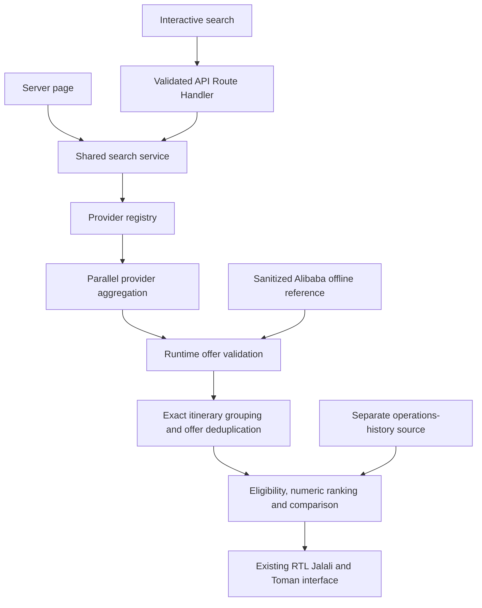

# Multi-provider interview demonstration

> **Current default update:** `/` now opens the restored full synthetic demo, including domestic routes and future-date generation. Use `?mode=live` for the disconnected provider view described here; `?mode=fixture` remains the isolated Alibaba reference. [DEMO_RESTORATION.md](DEMO_RESTORATION.md) is the current behavior and verification record.

Implementation reference: **2026-10-15**. This local iteration extends the existing Next.js/TypeScript application; it does not establish commercial access to Alibaba, Flytoday, Safarmarket or Snapptrip. Read [the data-source audit](DATA_SOURCE_AUDIT.md) for the inspected public evidence and its limitations, and [DATA_SOURCES.md](DATA_SOURCES.md) for integration prerequisites. No new provider requests, scraping, accounts or partnership messages are part of this iteration.

## Scope and access boundary

All four provider identities have server-side adapter interfaces and explicit disconnected live implementations. The user's subsequent direction narrows reference-port work to an Alibaba parser and stored responses from the supplied `torob-belit.zip`; Flytoday, Safarmarket and Snapptrip remain disconnected. The archive is now extracted and inspected under [reference/extracted/torob-belit](../reference/extracted/torob-belit). [REFERENCE_REVIEW.md](REFERENCE_REVIEW.md) records source evidence, contradictions and reuse decisions. The offline Alibaba port uses defensive parsing of sanitized reference records; it does not import the reference's live transport or fabricate independent offers from the other three providers. Completed local verification is recorded below.

| Adapter | Reference/fixture port | Live path | Missing access/technical requirements |
| --- | --- | --- | --- |
| Alibaba | Inspected parser/stored-response offline port; raw price unit remains unverified | `UNAVAILABLE`; access unverified | Official automated-search/comparison permission; approved hosts/endpoints; versioned specification; authentication/sandbox access; explicit price units, identity/time-zone mappings, quotas, cache and referral rights. Source token construction exists but server validity and authorization are unverified, so transport is not activated. |
| Flytoday | No new fixture adapter under the narrowed reference-port scope | `UNAVAILABLE`; access unverified | Written exception/agreement covering automated extraction and independent commercial comparison, beyond an organization purchasing panel; official API/feed specification, approved transport, authentication/sandbox access, quotas, currency and quote/deeplink contracts. Public extraction restrictions are recorded in the audit. |
| Safarmarket | No new fixture adapter under the narrowed reference-port scope | `UNAVAILABLE`; agreement required | Written outbound inventory/search-result consumption and republication permission, distinct from supplier onboarding; seller attribution/referral rights; API/feed specification, authentication/sandbox access, monetary units, quote expiry, limits and cache rights. Public terms require written permission. |
| Snapptrip | No new fixture adapter under the narrowed reference-port scope | `UNAVAILABLE`; agreement required | B2B approval explicitly covering flight search and independent comparison/display; technical specification, approved API hosts/endpoints, authentication/sandbox access, quotas, caching, monetary units and booking-link rules. Advertising B2B web services does not itself supply these. |

These are readiness gates, not claims that applications have been submitted or that credentials are the only remaining obstacle. No target has a connected live transport. Neither a token nor a local configuration flag grants permission or proves schema compatibility.

The reference's separate `AGENTS.md`, all actual JavaScript modules, frontend, tests and both JSON files were inspected. The source shows Base32 codec/token-building code, a browser-like-header network request, parallel search and fixtures. It also explicitly leaves the price scale and some token fields/server validation unresolved. Therefore the codec and record mappings can be reviewed locally, while the undocumented request generator, copied website header mechanism, automatic live-to-fixture fallback, fabricated other-provider prices and wrong-route fallback are rejected. No reference endpoint was called. Technical source inspection does not establish the authenticity of the files or permission for live access.

## Run and present the demo

Use the existing project runtime and lockfile:

```sh
npm run dev -- --hostname 127.0.0.1 --port 3000
```

If Node is not on the local shell's `PATH`, use the already-installed project runtime under `.tools/`; no additional application dependency is required for this iteration.

| Local URL / request mode | Behavior |
| --- | --- |
| `http://127.0.0.1:3000/?mode=live` or API `mode: "live"` | Explicit authorized-provider mode. Four transparent unavailable/readiness statuses; no fabricated inventory and no automatic fixture fallback. Omitted mode now selects the restored full synthetic demo. |
| `http://127.0.0.1:3000/?mode=fixture`, `/results?mode=fixture` or API `mode: "fixture"` | Explicit Alibaba offline reference demonstration. THR–MHD or THR–SYZ on `2026-10-15` only; other three provider slots remain unavailable. No network access. |
| `http://127.0.0.1:3000/`, `?mode=demo`, or omitted/API demo mode | Restored full synthetic demo with domestic routes, deterministic future dates and explicitly synthetic operational history. It is not imported reference-provider inventory. |

The Alibaba reference files contain departures on **۲۳ مهر ۱۴۰۵** (`2026-10-15`), exactly THR–MHD and THR–SYZ. They are not redated or substituted for unsupported route/date queries. The restored synthetic v4 demo generates supported routes deterministically throughout `2026-10-15`–`2036-12-31`; its historical reference remains fixed at `2026-10-15T12:00:00Z`, shown as **۲۳ مهر ۱۴۰۵** in Tehran. The old seven-date array is retained only as examples. The server chooses the initial demo search date once and passes it to the client; changing departure dates never advances the history reference or redates imported records.

For the reference demonstration, select fixture mode and inspect Alibaba's offline parsed schedules/details and compare itineraries. Prices explicitly say **«واحد مبلغ تأیید نشده»**: raw values may be shown in Persian digits without a تومان/ریال claim, and cannot establish a cheapest offer or satisfy a budget. The default demo demonstrates complete synthetic Toman seller comparisons and synthetic history. Explicit live mode demonstrates honest provider-unavailable statuses; none of these modes is a working real-provider connection.

The supplied files' recording authenticity/time and unit semantics remain unverified, despite the reference calling them real responses. The port labels them offline reference data with unverified provenance, strips unnecessary opaque quote/session identifiers, and leaves `capturedAt` null. A manifest's fixed local `importedAt` may populate the compatibility `fetchedAt` field only with explicit **local fixture import time** copy; it is never a successful provider retrieval or real-world update. No booking URL or operational history is invented.

## Source, delivery and status semantics

`sourceState` is explicit at the response/provider boundary and on normalized offers where an offer exists:

| State | Meaning |
| --- | --- |
| `LIVE` | Origin is an authorized real provider. Only a reviewed, documented and connected adapter may produce this; no current target does. |
| `FIXTURE` | Offline data, with authored synthetic versus supplied reference/unverified-capture provenance explicitly disclosed. It remains offline on every cache hit and in cards, details, comparison and API responses. |
| `UNAVAILABLE` | No usable source response/offer is available, including missing access, timeout or failure. A status never becomes a fabricated offer. |

Offer origin is `LIVE` or `FIXTURE`; an unavailable source yields a provider status, not a price record. Existing domain `DataSource.mode` values (`live`, `demo`, `unavailable`) remain available for compatibility: the synthetic demo and explicit offline fixture use `FIXTURE`, with source IDs/descriptions distinguishing them. Imported records are not labeled newly live, verified captures or verified synthetic data.

Delivery/cache status is independent from source origin. A cached authorized-provider result retains its origin but is visibly cached, never newly live; a cached fixture stays a fixture. Preserve the original retrieval or explicitly named import reference across cache hits. `queriedAt`/response time describes the request and cannot stand in for a successful provider update. Unavailable providers have no invented successful-update time. Reference seat/purchase flags are offline file observations, not present availability; a `LIVE` source state likewise does not itself reserve a fare.

## Architecture and normalization

The existing Next.js Route Handlers and Server Components both call shared server services. The explicit fixture registry routes only the inspected Alibaba offline parser through the reusable aggregation/normalization boundary; disconnected peers return statuses. The restored default synthetic demo uses its local generator and remains isolated from both provider modes. Domain functions do not choose transports or read credentials.



The shared [FlightOffer contract](../src/domain/provider.ts) preserves provider ID/name and provider offer ID, seller identity, airline/flight number per segment, exact origin/destination airports, UTC departure/arrival instants, stops, party/cabin, fare name/conditions, segment baggage, price and charge completeness, availability, ticketing/refundability, nullable approved booking URL, source and `fetchedAt`. Adapters return untrusted output that is validated at the shared boundary; strict TypeScript alone does not validate external JSON. The reference's raw price cannot satisfy the canonical-money invariant, so a separate typed unpriced branch preserves parsed records instead of inventing a zero or a unit.

Required identity/time/money/provenance fields cannot be invented when missing. Supported baggage, fare-condition and availability unknowns stay unknown. Exact airport reference coverage is still bounded to the verified metadata already in the application. Unsupported airport/currency mappings need a documented extension, not a guessed conversion.

Physical itineraries group only when ordered operating identities, exact routes and scheduled UTC instants match. Marketing codeshares are not guessed into operating identities. Provider/seller/offer identifiers keep each quote distinct, with latest revisions replacing older copies and conflicting equal-version records suppressed. Independent seller prices and baggage/fare conditions never collapse into one synthetic best-of offer.

Canonical verified money remains a nonnegative safe integer `{ currency: "IRR", unit: "rial", amountRials }`. Explicitly tagged Toman inputs are multiplied by ten exactly once; already-normalized rials remain rials. No exchange rate or unit inferred from an amount is allowed. Price filtering, ordering, ranking and comparisons operate on numeric rials, while the shared formatter renders Persian numerals, separators and **تومان**, preserving a one-rial remainder. Existing demo fares are authored synthetic values.

The reference's monetary unit is explicitly unverified in its own `AGENTS.md`; JSON has no currency/unit field. `UnpricedFlightOffer`/`UnpricedFlightSearchResult` preserve raw `priceAdult` evidence, `totalPrice: null` and `priceComplete: false`, exposed separately as `unpricedFlights`. The existing card/detail/comparison UI accepts the typed union and shows unknown-unit copy rather than `formatToman`. An active budget excludes these records, price-derived ranking is inactive, and they cannot become cheapest/seller-price comparisons. Fixture price/history sorting controls are disabled; API requests for either return `422 UNSUPPORTED_FIXTURE_SORT`. The recommended label becomes **«برنامه سفر مرجع»**, with schedule/departure/duration ordering and detail comparisons only. This is a deliberate missingness extension, not an assumed rial-to-Toman conversion.

Raw reference schedule strings have no offset. The fixture interpretation explicitly assigns `Asia/Tehran` for these domestic THR/MHD/SYZ records to avoid host-zone drift; this is an offline demonstration assumption, not verified provider UTC semantics. Real operating identity, ticket protection, fees and baggage units remain unconfirmed and cannot support affirmative claims or unrelated hard filters. A documented provider contract must resolve these before live activation.

Search dates remain Gregorian ISO date-only strings; scheduled instants remain UTC timestamps. Existing Temporal-based Jalali conversion, Persian month names/numerals, airport-zone formatting, date picker, RTL behavior and [Design.md](../Design.md) tokens/components are retained. This iteration introduces no replacement design language.

## Concurrency, deadlines, cache and failures

- Dispatch providers in parallel and settle them independently. A provider failure must not discard valid peer offers; statuses identify unavailable/error/timeout/rate-limited peers. This behavior can be exercised with synthetic test transports without pretending to have real vendor payloads.
- Default to a **6-second total deadline per provider**, including attempts, transient backoff and retries. Pass an `AbortSignal` and enforce a timeout race for adapters that do not cooperate. An unsuccessful provider cannot prolong its budget by starting another attempt. These are local demo defaults, not measured vendor SLAs.
- Retry only explicit transient failures, bounded by the same deadline. Preserve the existing bounded 250ms/500ms backoff policy. Authentication, forbidden/challenge and invalid-data failures do not trigger evasive retries. Rate limiting respects `Retry-After` and the existing conservative provider cooldown rather than rotating credentials or identities.
- Successful results, including genuine empty results, use a **60-second cache**, bounded to **200 entries per process**. Keys must distinguish execution mode, provider, exact normalized query/party/currency and any eventual fixture version. Identical in-flight requests share work without sharing mutable response objects. Do not cross-contaminate offline and live caches.
- Expired cache is not silently returned as current after a failure. Cache TTL is not a provider quote-validity guarantee; once real contracts exist, approved cache rights, quote expiry and final-price/availability revalidation must take precedence.
- Cache, in-flight deduplication and cooldowns remain process-local. They do not provide durable history, cross-instance quota control or a production distributed cache. A restart clears them. Multiple processes/instances would need coordinated infrastructure and provider-specific limits before deployment.

No active provider secret names or undocumented endpoint configuration are invented. Future credentials belong only in server environment/secret storage under the officially documented authentication contract; never use `NEXT_PUBLIC_*`, client-provided base URLs or website cookies. Stop on access controls, challenges and disallowed extraction; offline fixtures are an explicit demo option, never a bypass or automatic fallback.

## Cancellation history stays independent

Ticket availability, fare refund conditions and inventory responses are not operational cancellation evidence. Future reference-inventory fixtures and live inventory both have **«اطلاعات کافی موجود نیست»**, a null headline cancellation percentage and no favorable fabricated category until a separate trustworthy operations source is available. Inventory-supplied synthetic history is not promoted into real risk.

The restored default `mode=demo` retains clearly synthetic history to demonstrate the existing algorithm separately. Its exact service matching, previous 30 completed origin-local days, 10-known minimum, verified expected-operation roster and 80% coverage gate, revision/conflict reconciliation and retrospective labels remain unchanged. Historical fractions are never calibrated future cancellation probabilities.

## Next authorized integration step

1. Resolve the offline reference's unanswered provenance, monetary-unit/party/charge basis and schedule/identity semantics with reliable supporting evidence. Local code inspection is complete and recorded in [REFERENCE_REVIEW.md](REFERENCE_REVIEW.md), but its divide-by-ten constant does not answer those questions. Preserve unknown fields until resolved.
2. Obtain written read-only search/comparison/display/cache/referral rights and the official versioned specification, approved hosts and sandbox access for one provider. [Snapptrip's advertised B2B web-service route](https://b2b.snapptrip.com/landings/b2b) is the strongest documented lead in the existing audit; it is not evidence of granted access. Do not send outreach without human authorization. Alibaba's source token builder and browser-header mechanism are not an alternative authorization path.
3. Implement a single server-only official transport/mapping behind its existing named adapter. Add sanitized contract fixtures covering operating identities, airports/time zones, party total/fees, explicit rial/Toman units, baggage/conditions, quote expiry, availability and approved booking URLs.
4. Run contract tests and an approved low-volume sandbox search, verify attribution and freshness labels, tune retries/cache to documented limits, then enable that provider explicitly. Keep disconnected peers visible. No fixture test certifies real API compatibility.
5. Obtain a distinct verified operations-history contract before showing real cancellation percentages. Public deployment, paid onboarding and booking remain separate decisions.

## Current verification

The restoration passed lint, typecheck, **364 unit tests across 13 files**, production Webpack build and **all 22 browser tests** in 21.1 seconds. Current demo behavior and scope are recorded in [DEMO_RESTORATION.md](DEMO_RESTORATION.md).

## Historical reference-integration verification

The earlier reference integration passed `npm run lint`, `npm run typecheck`, **323 unit tests across 11 files**, `npm run build` (Webpack), and **all 19 Playwright browser tests** in 17.8 seconds. That run included the existing 15 regressions and four reference-fixture checks. Coverage included attribution, unknown-unit prices, exact route/date handling, disabled price/history sorting, schedule comparison, Jalali/Toman/RTL behavior, mobile layout and unavailable real sources. These historical counts do not certify the restoration.

The supplied reference's **four original Node tests ran and passed separately**. They verify local codec/parser assertions, not provider connectivity, token acceptance, price units or capture authenticity. Historical counts are labeled separately in [DATA_SOURCES.md](DATA_SOURCES.md). These local results do not certify supplier compatibility or a live connection; live-provider contract tests require an official contract and authorized environment.
